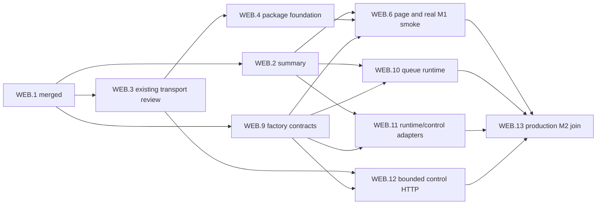
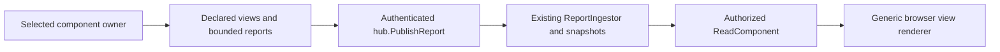
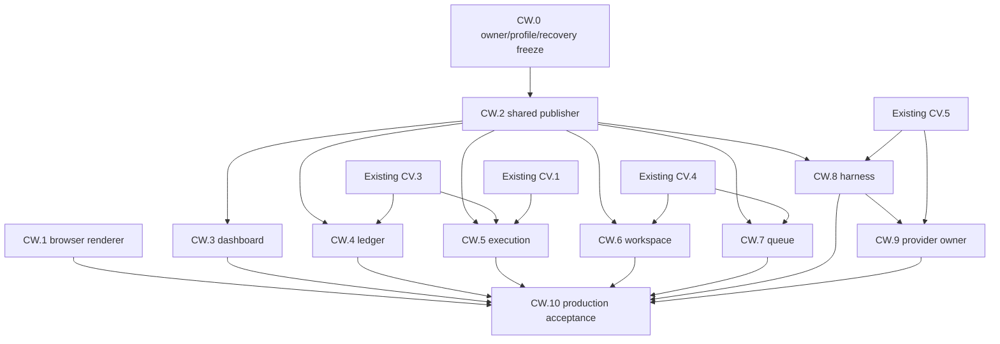

# Local cockpit and automatic queue operation

Accepted scope amendment: 2026-10-18. The user requested the smaller personal
cockpit design be applied to the spec and deeply specified beads. This replaces
the first-delivery sequence accepted on 2026-10-13. Implementation remains paused;
this planning update does not resume dispatch, spend, or resolve execution gates.

Canonical bead index: [web-dashboard-beads.md](web-dashboard-beads.md).
Epic `agalma-rwn` now delivers the first operator cockpit. The original broader
generic-plugin browser promise is retained in deferred epic `agalma-v38`.
Historical inputs/receipts stay immutable. The prior spec/index remain in Git;
before-amendment own bead fields are retained as JSON planning evidence.
This document owns the design; implementation task details live in beads.

## Product and delivery

One operator starts a local factory for one repository/state directory, opens its
printed loopback URL, sees the eligible queue and execution progress, and leaves
workers consuming eligible work automatically. The cockpit remains available
through an empty queue, long tasks and admission pause. Pause/resume controls use
existing factory authority and durable receipts. High-level planning through
concierge is a later increment; there is no per-task Dispatch button.

Two milestones keep a visible page ahead of runtime integration:

| Milestone | Observable result | Acceptance owner |
|---|---|---|
| M1: open the cockpit | Actual browser shows real overview/executions/component health through the production host | WEB.6 |
| M2: operate the queue | Continuous automatic eligible-work consumption, responsive busy/idle UI, verified pause/resume and restart recovery | WEB.13 |

The first page also shows available economics/timeline and eligible work/runtime
observations when supported. Unknown costs, worker state and source availability
remain explicit. M1 may show the factory runtime endpoint unavailable with
controls disabled; this is an intermediate delivery, not M2 acceptance.

Remote access, shared accounts, a frontend framework/npm pipeline, task/backlog
editing, arbitrary commands, per-task worker/model selection, rich plugin-detail
pages, artifact downloads, generic plugin actions and concierge UI are outside
the first release. Existing queue eligibility/approval/stop/spending policies
remain mandatory. Automatic queue consumption does not create/release new tasks.

## Existing implementation and reuse

The inspected main baseline is `1f3649480dbf05472dc5987b38c229c2c4a9b55b`.
HP.1–HP.7 and WEB.1 are closed/merged. HP.8 is incomplete. WEB.2 and WEB.3 have
retained uncommitted worktrees; WEB.3's latest focused evidence records 19/19,
with final review still pending. No dashboard package/browser page exists yet.

`status.rs` now consumes a selected ledger handle; it is not the old direct-SQLite
recipe. Existing snapshot/economics/component functions cover executions,
timeline, costs and registry/report-derived plugins. Reuse those calculations
through hub-owned adapters, without importing conductor implementations into the
dashboard. HP.6 already supplies common component/view derivation.

`work.rs` already selects/claims eligible tasks, freezes inputs, applies budgets
and drives execution/recovery. It currently exits on an empty queue and refuses
stopped entry before starting the plugin host. Its attached host lacks the
standalone host's continuously progressing supervision/callback-serving path.
The runtime increment explicitly repairs those gaps; assets alone cannot do so.

## Package and process boundary

Retain `agalma-web-dashboard` as an independently installed/supervised process.
Its package supplies executable, manifest, configuration schema, protocol version
and committed browser assets. Use public contracts and IPC only. Discover and
launch through the existing registry/supervisor; no dashboard-specific core
import, peer discovery, second supervisor, SQL or private ledger open.

Rust serves compiled HTML/CSS/browser JavaScript modules and bounded HTTP API.
WEB.4 generates a deterministic inventory using std-only build logic; adding an
asset does not require editing server source. Watch source assets, never an
OUT_DIR output. WEB.4 owns Cargo/package/build/server and distinct `health.html`;
WEB.6 owns final page/modules/browser support. No new dependency/download is
authorized. A build-script change includes existing no-op rebuild verification.

Bind `127.0.0.1`, default port 0; reject foreign addresses. Print/report actual
URL only after listener/read binding readiness. Configuration refresh interval
is 1–60 seconds, default 1. Health distinguishes listener, binding and runtime
availability. Missing optional runtime support does not make M1 startup fail.

## Continuous runtime and ownership

Add explicit `agalma work --watch --repo <repo> --state-dir <state>
--plugin-root <packages>`. Reject `--watch` with `--once` or `--max-tasks`.
Existing ordinary batch/once/max-tasks behavior and exit codes remain covered.

One runtime holds the existing state-directory admission lock. One worker owns
queue selection, claim, frozen admission and serial execution. Empty successful
queue means Idle and an interruptible five-second wait; later eligible work runs
through the existing pipeline. Queue error means Unavailable with capped retry
(5 seconds initial, 30 seconds maximum), never successful empty state.

On admitted startup, run existing frozen-package recovery before new claims,
then existing reap/reconciliation/review policy in its established order. Do not
repeat startup recovery/planning on every idle scan or add automatic release,
mining, recurring concierge or a parallel builder scheduler. M3's durable cadence,
operator-directive release, backup and 72-hour acceptance remain separate work.

Three responsibilities progress independently:

1. The worker runs synchronous task execution and is the sole claimant.
2. A host/probe supervision owner is constructed/used in its own context and
   continues supervision during idle, running and paused states (nominal 250ms
   tick with existing backoff). Share only safe selected-ledger/router/report
   handles and short-lived snapshot copies; never mutable host/queue/executor.
3. The hub callback/control event loop remains responsive while the worker
   blocks. The supervised dashboard process separately serves browser HTTP.
   A supervision thread alone is insufficient. Never hold a worker/router lock
   throughout a task or slow read. Wake hints use a bounded channel (capacity16);
   coalescing a hint never drops the durable stop decision.

Pause blocks new admission through existing stop policy; it is not a new cancel
operation and does not change current in-flight phase-stop semantics. Resume
requires the existing human confirmation and receipt. Wake/recheck actual stop
state instead of treating a successful HTTP response as observed worker state.

Continuous-mode startup with STOP/latch may serve observations and confirmed
resume only against readable, compatible established storage. Never initialize,
replace or migrate fresh/missing/corrupt state under stopped admission, clear
stop automatically, or dispatch while recovery/stop authority is unknown.
This is an explicit continuous-mode change, not behavior already in `work()`.

Graceful shutdown stops admission, uses existing cooperative phase/cancellation
deadlines to reach a terminal/parked boundary, then stops/joins hub serving and
host owners, drains owned plugin processes, and finally releases the lock. Forced
termination can leave durable nonterminal execution; next permitted startup
recovers from frozen packages before new work. No fabricated terminal receipt
or force-unlock. Fatal worker failure is visible and requires explicit runtime
restart; plugin-child restart does not create a fresh queue claimant.

## Summary reads

Keep immutable WEB.1 `ControlPlaneRead/v1` / `BrowserWire` and scoped
`control-plane.read/v1`. Supported first-release operations are `read_overview`
and `list_components`, exposed as GET `/api/v1/overview` and
GET `/api/v1/components`. Grant scope/expiry/revocation remain server-validated.

ReadOverview contains stop observation, executions, usage/cost/allowance and
curated timeline from bound APIs. Sources distinguish missing, unreadable,
unknown, successfully empty and available. Unknown usage/allowance is null, not
numeric zero. Missing stop authority cannot become a green Running indication.
No implicit atomic snapshot is claimed across sources.

Overview is capped at100 executions/100 timeline entries and256KiB actual wire
JSON with visible truncation. Component pages default50, accept1–100, and stay
within256KiB including metadata. Sort by opaque ID; cursor pins collection,
filter and revision. Mutation/retired generation invalidates the collection;
RevisionConflict means reacquire. Fingerprint revisions are not monotonic clocks.

Use installed binding/version/config pins plus live host lifecycle/health. An
old Ready report cannot hide a Failed/Retired registry observation. Include
installed unavailable plugins. Do not derive liveness from socket presence.
Preserve exact decimal strings for identity/money in browser projection.

Keep reads available while admission stopped, bounded by five seconds including
queueing/source work, and release router locks before slow I/O. Reads create no
claims/actions. Component-report/artifact operations explicitly unsupported in
this slice; their HTTP routes are absent. Preserve their old code/tests/evidence
before editing the retained WEB.2 worktree. Timestamp/digest matching never
establishes missing producer provenance.

## Factory contracts

WEB.9 defines additive `factory.rs` types, strict codecs and independent golden
fixtures. Existing ControlPlaneRead/v1, HP envelopes and LedgerApi are unchanged.
Capabilities separate `factory.read/v1` (snapshot/lookup) from
`factory.control/v1` (pause/resume). No public body contains actor or credentials.

Requests use exact tags/fields; unknown fields/families/versions fail:

```json
{"format":"FactoryRuntime/v1","operation":"snapshot","limit":50,"cursor":null}
{"format":"FactoryControl/v1","operation":"lookup","action_id":"op-1"}
{"format":"FactoryControl/v1","operation":"pause","action_id":"op-2","confirmation":null}
{"format":"FactoryControl/v1","operation":"resume","action_id":"op-3","confirmation":"resume"}
```

Snapshot limit defaults50/accepts1–100; nullable cursor≤4096 UTF-8 bytes. Omitted
snapshot paging fields take defaults. Action IDs are1–128 ASCII characters from
`[A-Za-z0-9._-]`; action confirmation is required nullable and≤64 UTF-8 bytes.
Preserve exact submitted confirmation for input identity, then apply existing
trimmed confirmation semantics. Request digest is canonical SHA-256 over the
complete validated action object, excluding outer grant/deadline/operationID,
session and CSRF. Distinct submitted input with the same actionID conflicts.

FactoryRuntime/v1 response required fields:

| Field | Exact content |
|---|---|
| format | `FactoryRuntime/v1` |
| repository_id, state_id | Nonempty opaque configured identities≤256bytes; no private absolute paths |
| runtime_instance_id | Nullable opaque launch identity≤128bytes |
| observed_at_unix_ms | ExactU64 decimal string |
| status | Exactly Starting, Recovering, Idle, Running, Paused, Failed, Unavailable |
| reason | Nullable text≤2048bytes |
| sources | Exactly five unique records for runtime, worker, queue, execution, stop |
| stop | Nullable stop observation |
| current_execution | Nullable observed execution summary |
| eligible | Bounded eligible-work page |
| permissions | `{pause:bool,resume:bool}`, false by default |

Source record: `{source,state,detail,observed_at_unix_ms}` using existing
SourceState, nullable bounded detail and nullable ExactU64 timestamp.
Stop: `{stopped,reason,observed_at_unix_ms}`, bounded nullable reason and exact
timestamp. Execution: `{execution_id,task_id,generation,phase,state,
updated_at_unix_ms}` using existing phase/state enums, exact generation, nullable
exact update time and IDs≤256bytes. Unknown time is null, never invented zero.

Eligible page: `{entries,revision,total,next_cursor}`; entries are
`{task_id,title,priority,family}` using TaskPriority/TaskFamily, title≤1024bytes,
IDs≤256bytes. At most100 entries and256KiB entire response. Revision is nullable
opaque string≤128bytes; total nullable ExactU64; cursor nullable≤4096bytes.
Sort task_id for display; this does not change dispatch selection priority.
Unavailable can have null launch/revision/total/execution and empty entries
without claiming a successfully empty queue. All nullable response keys exist.

Observation seam in contracts:

```rust
pub trait RuntimeObservationSource: Send + Sync {
    fn snapshot(&self, request: &FactoryRuntimeRequest)
        -> Result<FactoryRuntime, ContractError>;
}
```

WEB.10 owns queue order/revision/cursor/source truth; WEB.11 only validates and
adapts it. Queue cursor is canonical JSON text, opaque to browsers:
`{format:"FactoryQueueCursor/v1",repository_id,state_id,runtime_instance_id,
revision,after}`. Fields are bounded/nonempty and pin scope/launch/collection.
Malformed/wrong scope returns InvalidRecord; changed queue revision/launch
returns RevisionConflict. Golden literals freeze encoding. WEB.10's raw source
permissions default false. WEB.11 is the sole trusted permission composer: it
may enable pause/resume only from source availability, the authenticated caller's
current approved factory.control binding, exclusive owner and observed stop
state. WEB.13 supplies the live binding/owner resolver. WEB.12 and the browser
can only narrow this result. UI permissions are hints, never admission authority.

FactoryControl/v1 responses are strict tagged variants, all with nullable live
`observed_stop` separate from immutable history:

- `result:"receipt"`, `receipt:{action_id,request,request_digest,outcome,
  reason,ledger_action_id,actor,recorded_at_unix_ms}`. Outcome applied/denied,
  actor human, timestamp exact, nullable reason≤2048bytes.
- `result:"unconfirmed"`, original action_id/request/request_digest,
  `code:"EffectUnconfirmed"`, bounded reason; no terminal receipt.
- `result:"not_found"`, action_id. Only authoritative lookup can say absent.

Whole response≤256KiB. Reuse existing FailureCode values; no frozen failure enum
extension for HTTP-only session/content errors. A completed historical timestamp
is replayed exactly. Receipt success and observed worker progress are distinct.

## Control replay, stop admission and authority

Existing `ControlPlane::apply` changes latch/STOP before recording an outcome;
it does not preserve complete original request identity or atomically commit all
effects. The new API promises conservative replay, not atomic exactly-once
completion. Preserve legacy CLI/TUI apply/cancel behavior.

One serialized API control owner holds a dedicated state-scoped
`factory-control.lock` guard; a process mutex alone is insufficient. WEB.13
establishes ownership for the service lifetime. Unbound/competing owner means
disabled controls. Legacy CLI/TUI never uses this API's reserved action IDs.

Use existing declared ControlReceipt storage, with deterministic IDs
`factory-control.intent/<action_id>` and `factory-control.result/<action_id>`.
Fields use action pause/resume, target empty, actor human, and a namespaced
`factory_control_v1` detail with stage, exact request and digest; terminal detail
adds actual outcome/reason. No SQL or parallel journal framework.

1. Authenticate method/capability/pinned identity/expiry and strictly decode.
2. Serialize at exclusive owner; recheck deadline/authority after waiting.
3. Matching completed record replays exactly; conflicting input fails before
   effects. Matching orphan intent returns unconfirmed without reexecution.
4. Otherwise persist intent before effect; uncertain intent write never
   authorizes effect. Reconcile or return explicit unavailable/unknown.
5. Apply existing human guards/checked pause/resume semantics, then persist and
   return terminal result. A mutation/result-write failure leaves uncertainty.
   New-path Resume must not claim success if STOP removal/observation failed.

Lookup is observational. An interrupted effect/result boundary returns
EffectUnconfirmed; browser does not retry with another ID automatically. A
stronger atomic guarantee requires a separate ledger prerequisite.

Pause/resume must be callable while admission stopped. Add a narrow authenticated
factory-control exception after operation validation; do not disable ordinary
effect stop policy or admit arbitrary plugin capabilities. Missing/unreadable
state still fails closed. Read/lookup remains observational while stopped.

Control authority is explicit for the installed dashboard binding/package digest,
not inherited from auto-install, a UI actor field or plugin report. Do not add
factory.control/v1 to the automatic safe-capability allowlist. Default package
is read-only. Live grant expiry/revocation/generation still gates every call.

## Private launch bindings and HTTP controls

WEB.13 issues a generic private descriptor, WEB.12 parses/consumes it:

```json
{"format":"PluginCapabilityBindings/v1","bindings":[{"capability":"factory.read/v1","hub_socket":"<private path>","grant":"<private token>","plugin_id":"<installed id>","generation":"1"}]}
```

Environment key `AGALMA_PLUGIN_CAPABILITY_BINDINGS`, max64KiB/16 unique capability
entries. Capability≤128bytes, pluginID≤256bytes, exact generation; socket/token
remain bounded by existing launch constraints. Reject duplicates/malformed
binding identity; no log/Describe/HTTP disclosure. Preserve legacy first-grant
inputs for old clients, but never use a read/report token as control fallback.
Issue/rotate/revoke each approved capability independently. This private additive
channel does not change public frozen HP envelopes.

| HTTP route | Capability/behavior |
|---|---|
| GET /api/v1/factory | factory.read snapshot |
| GET /api/v1/factory/actions/{action_id} | factory.read receipt lookup |
| POST /api/v1/factory/pause | factory.control pause |
| POST /api/v1/factory/resume | factory.control confirmed resume |

Retain configured loopback Host and same-origin policy. With explicit actual
control binding, same-origin factory GET may bootstrap per-launch independent
32-byte OS-random session/CSRF tokens. Cookie `agalma_operator`, HttpOnly,
SameSite=Strict, Path=/api/v1/factory; plain loopback HTTP omits Secure. Separate
CSRF in `X-Agalma-CSRF` response header, Cache-Control:no-store. Tokens never in
URLs/errors/logs; rotate on restart. No accounts/framework. No control binding
means no session/outbound mutation and disabled permissions.

POST requires exactly one valid Origin matching actual scheme/host/port, valid
cookie+CSRF, live explicit control binding and bounded strict JSON with matching
route operation. Missing/foreign/duplicate/malformed Origin fails. Body≤8192bytes
including streamed/chunked input, application/json with optional charset=utf-8.
The existing max16 admitted requests and five-second total budget apply to body
acquisition/queueing/RPC/response. No unbounded slow-body/admission queue.

HTTP mapping: completed applied/denied receipt200; unconfirmed202; lookup
not_found404; identity/revision conflict409; invalid schema/input400; authority,
session/Origin/CSRF or disabled controls403; unavailable/busy503; deadline504;
body413; contenttype415; unsupported method405; unknown route404. A possible
effect on timeout/disconnect is unknown, not cancelled; retain ID for lookup.
Keep bounded safe errors and no secret reflection. WEB.3 read/drain behavior
remains protected. Only declared control routes accept POST.

## Browser state and refresh

Use one page and browser-native modules. `api.js` validates contracts;
`app.js` renders the shell; `refresh.js` owns reads; `controls.js` owns explicit
pause/resume interactions. Independent WEB.9 JSON fixtures let UI and backend
develop in parallel. No private implementation imports or remote UI dependencies.

One refresh cycle at a time, default1s/config1–60s, abortable5s requests. Track
last success per source; one failing endpoint does not erase successful others.
Retain failed-source data visibly stale; first failure is unavailable. Generation
change replaces old current row state. RevisionConflict resets page collection;
older aborted replies cannot overwrite later cycles. Page exit stops timers and
requests. Opaque identities/revisions/money never become floating point.

Use textContent/createTextNode for plugin text. Bound text4KiB, rows100/page,
explicit truncation/Next. Never evaluate report HTML/scripts/templates. Controls
disabled when runtime/permission unknown or absent. Explicit Resume collects
literal existing confirmation. Pending click retains one actionID; lost result
queries it. GET/refresh/navigation/reconnect/reload never repeats POST.

## Parallel ownership and task graph

Three active implementation streams, not one chain of eight browser tasks:

| Stream | Tasks | Exclusive source ownership |
|---|---|---|
| A | WEB.2 summary; WEB.9 contracts; WEB.11 adapters as available | Read handlers/economics/routing/contract exports; lib.rs after WEB.2 |
| B | WEB.10 continuous runtime | work.rs, cli.rs, work/factory_runtime.rs; composition after WEB.2 |
| C | WEB.4 foundation then WEB.6 page | Cargo/package/server/build, then page/assets/browser support |

Finish existing WEB.3 review separately. WEB.12 gets IPC ownership after WEB.3
and uses the next free implementation slot; fixed fixtures allow work without
WEB.10/11 runtime completion. Initially summary/contract/package work can overlap;
once contracts and summary land, runtime/adapter/browser work can overlap.
The three-session limit is a dispatch cap, not a claim that every dependency
wave has width three. The four-task ready wave queues its fourth task until a
slot opens; necessary contract and final integration joins remain sequential.

WEB.10 declares `work::factory_runtime` from its owned work.rs, avoiding concurrent
lib.rs edits with WEB.11. Composition transfers WEB.2→WEB.10→WEB.13. Package server
transfers WEB.4→WEB.13. Browser support begins WEB.6, then later readers consume
the same harness. No concurrent shared-file ownership or competing inventories.



## Verification, review and delivery

Each bead contains concrete files, algorithms, failure/recovery states, target
selection, property budget/seed, prerequisites and stopping conditions. Use
`make test-focused SELECTION=...`/unified runner, named task worktrees and
absolute redirected caches. Keep all raw logs/commands/environment/source/pending
identity/fixtures/results under primary `target/test-runs/<bead>/<run-id>/`.
Required browser/binary cases execute; missing/ignored/zero is failure.

Contract/read/transport tests precede integrations. WEB.4 package-level fixture
tests prove executable/bootstrap, not production hub composition. WEB.6 proves
actual M1 with installed CHROME_BIN and real hub/dashboard/ledger. WEB.13 proves
actual continuous runtime/controls with deterministic local reference tasks:
empty→Idle→eligible task→busy responsive UI→pause holds next claim→confirmed
resume→one next claim, plus read-only/refused controls, duplicate/conflicting
identity, interrupted intent/effect/result, frozen restart recovery, second-owner
refusal, stopped-established versus fresh no-init and clean shutdown.

WEB.6 browser acceptance is intentionally bounded to one production smoke plus
six fixture browser regressions: safe bounded rendering of real fixture data;
inert injected text; stale-source retention and conflict reload; bounded
component paging; permission-gated controls with receipt lookup and no replay;
and page-exit timer/abort cleanup. The production smoke opens the installed
dashboard in CHROME_BIN and checks real overview/execution/component data,
source loss, and disabled controls without a grant. Do not run the prior
128-sequence browser state-machine corpus as a WEB.6 release gate. Broader
generated and out-of-order coverage is deferred to a later task if a concrete
regression justifies it.

Save independent deterministic property generators/assertions, boundary/invalid
cases and minimized replay data in repository tests. Budgets are specified per
bead; use existing native infrastructure, no new framework. No paid provider.
Run at most two isolated test binaries concurrently by default, coordinate cache
compilation, keep unique state/ports/profiles. Do not run full workspace per bead;
preserve later WEB.8 full acceptance. Broader new runtime checks need a named
coverage reason, not a routine second suite after passing focused evidence.

Implement via OpenCode DeepSeek Flash/Luna. Separate DeepSeek reviews routine
package/UI work; Sol reviews contracts, routing, control uncertainty and runtime
integration. Validator structural difficulty labels do not automatically select
review model. Stop at accepted evidence/handoff or one blocker/30-minute bounded
investigation. Commit/merge only reviewed explicit task paths before closure,
stamp actor/implemented-by, preserve evidence and remove only clean merged task
worktrees/caches. No push. Current planning does not dispatch implementation.

## Retained later platform and concierge scope

Deferred epic `agalma-v38` owns the original generic reporting-browser promise.
WEB.5, WEB.7 and WEB.8 keep their IDs under that parent. Its provenance design
and implementation tasks distinguish producer publications from recovered state:
frozen PluginSnapshot/v1 cannot reconstruct all original identity. Design first,
then actual versioned source/client implementation; rich renderer depends on
implementation, not a design closure. No timestamp/digest heuristic.

Retain six blocks Status/Metrics/Table/Timeline/Alert/ArtifactLink; literal/slash
field selectors with ~0/~1 escapes; bounded generic fallbacks and unknown versions;
no plugin code/templates/private payload types in hub. Rich navigation derives
from registry with stable identity/generation. Deferred artifacts use current
authorized immutable references,64KiB chunks/16MiB totals, confined verified
storage and attachment/no-sniff. Keep stale/gap/restart/generation recovery and
previously unknown independently built plugin proof with unchanged hub/dashboard
digests. WEB.8 retains one full workspace acceptance after its focused proof.
HP.8 remains a prerequisite for that platform proof, not the first cockpit.

Deferred task `agalma-1o7` designs concierge goal intake using existing planner,
budgets, frozen inputs and human execution gates. Planning produces proposals;
authority makes work eligible; the same queue worker consumes it. No second
scheduler or inferred execution approval from submitting a goal. Defer means
deliberate postponement, not a fake execution-approval date.

## UI v2 amendment: multi-page cockpit and design pass

User-directed increment after the M1/M2 cockpit delivery (epic `agalma-82f`,
2026-10-18). Scope: multi-page navigation over the currently available reads,
the hub component registry with health, task and project views, component detail
and dashboard self-health routes, and a full visual (`dashboard.css`) pass. No
new hub contracts and no new data semantics: every page renders existing
`ControlPlaneRead/v1`, `FactoryRuntime/v1` and dashboard health observations.
Full task metadata (budget/acceptance/base_ref/target/directive) remains
unavailable in this increment; it lives in taskqueue records and is not exposed
by any read contract. Implementation stays subject to the standing rules:
independently installed/supervised `agalma-web-dashboard` process, loopback-only
HTTP, compiled asset inventory, `textContent`-only rendering,4KiB text/100-row
bounds, explicit unknown/stale states, no POST from navigation, page-exit
timer/abort cleanup, no downloads or frontend frameworks.

### Pages and hash routing

One compiled shell (`index.html` plus browser-native ES modules). Hash routes:

| Route | Page content | Reads |
|---|---|---|
| `#/overview` | runtime status, stop latch, current execution, economics, timeline, controls | overview + factory |
| `#/components` | registry table: plugin id, name, generation, health, freshness, completeness, available, declared views; opaque-cursor paging | components |
| `#/components/<plugin_id>` | binding pin, declared view descriptors, bounded report envelopes | `read_component` via new HTTP route |
| `#/tasks` | eligible queue (id, title, priority, family, total, revision) and executions (phase, state, attempt, revision, updated) | factory + overview |
| `#/projects` | repository/state opaque identity, the five runtime sources, stop state, component count | factory + components |
| `#/system` | dashboard self-health (listener URL, binding, health state, version, detail), refresh interval and read-source states | new `/api/v1/status` |

Hash routing is required: the preview target and the Rust transport serve one
static shell, so deep links must not need a server rewrite; the History API is
rejected. An unknown or empty hash resolves to `#/overview` with a visible
notice. Navigation, hash change, reload and refresh never submit a control POST.
Read registration is unchanged except for the detail read: overview, factory and
components keep their existing always-on registration (component data also
feeds the Projects page count); only the detail read is route-active, fetching
while its route is active and short-circuiting otherwise so the refresh module
itself needs no change. The controls panel moves to the overview page unchanged
in behavior. The brand heading "Agalma cockpit" and the honest
runtime-unavailable wording remain (retained DOM contract).

### New read routes

Exactly two new dashboard routes, read-only, reusing the existing adapter gate:

- `GET /api/v1/components/{plugin_id}`: `read_component` page (`limit`1–100
  default50, opaque `cursor`). The transport already refuses smuggled path
  separators; the handler validates the decoded segment with the single shared
  component-id rule (exposed `pub` in `agalma-ipc`, reused, not duplicated).
  Malformed plugin id or request →400 `invalid_request`; cursor revision
  conflict →409 `cursor_conflict`; deadline →504 `read_timeout`; binding
  unavailable →503 `read_unavailable`; success →200 exact `BrowserWire`
  projection with exact decimal string identities. A valid but unknown plugin
  id answers200 with missing-source metadata and the page renders the honest
  not-registered state, never404 and never an empty healthy page.
- `GET /api/v1/status`: local process facts only, never hub data and never
  requiring the read binding. Strict JSON `DashboardStatus/v1`:
  `{format,version,health_state,listener:{state,url},binding:{state},detail,
  observed_at_unix_ms}` with Ready/Degraded/Unavailable derived by the existing
  `plugin.Health` rule and nullable bounded detail. Private launch inputs
  (socket, grant, capability token, config path, config digest, generation,
  capability bindings) never enter any browser response.

### Browser modules, fixtures and verification

Module layout: `api.js` (adds `getComponentDetail`, `getStatus`), `refresh.js`
and `controls.js` unchanged, new `router.js` and `ui.js`, and `pages/
{overview,components,component,tasks,projects,system}.js` with `app.js` as the
shell. All WEB.6 invariants carry over. Visual pass: design tokens with
dark-first `prefers-color-scheme` light override, sidebar→top nav at720px,
status/health pills, card panels, dense sticky-header tables, timeline stream,
`focus-visible` rings, monospace reserved for ids/digests/cursors/code, no
webfonts/downloads/frameworks. New fixtures `component-detail.json` and
`status.json`; `make start` previews every route offline with a committed
stdlib-only preview server. Browser acceptance extends the retained
`browser_support` harness; Rust route cases extend the `package_lifecycle`
patterns and one `agalma-ipc` focused check covers the exposed validator.

### Task mapping and waves

Four beads under epic `agalma-82f`, split by exclusive file ownership so wave 1
runs three sessions in parallel (the dispatch cap):

| Wave | Bead | Owned surface |
|---|---|---|
| 1 (parallel) | UI.1a `agalma-82f.1` | every browser JS/HTML file: shell, router, nav, `ui.js`, six pages, `api.js` validators |
| 1 (parallel) | UI.1b `agalma-82f.3` | `dashboard.css` only |
| 1 (parallel) | UI.2a `agalma-82f.2` | the two read routes, pub validator, fixtures, preview server, route tests |
| 2 | UI.1c `agalma-82f.4` | browser suites (`cockpit_page`, `first_launch`); the single verification gate; blocked by all three wave-1 beads |

The client module contract (router/ui exports, CSS class list, retained
`Cockpit`/`startCockpit`/`boundedText`/`formatTimestamp`/limits exports, brand
h1 and `#app` root) is frozen in the UI.1a bead design and is normative for all
four beads. Human gates: `agalma-5fv` (UI.1a), `agalma-ee0` (UI.1b),
`agalma-9ur` (UI.2a), `agalma-2be` (UI.1c); compact index in
[web-dashboard-beads.md](web-dashboard-beads.md).

## Live start amendment: real cockpit by default

User directive 2026-10-19: `make start` must show live factory state, not
fixtures. The fixture preview remains available as `make preview` for offline UI
work. Live operation uses the existing production runtime; no new observation
mode and no mocked route is added.

| Target | Behavior |
|---|---|
| `make start` | builds `agalma` + `agalma-web-dashboard`, seals the dashboard package into `target/live/plugins` (default), then runs the real `agalma work --watch --repo <repo> --plugin-root <root>` runtime; it prints `DASHBOARD_URL`/`AGALMA_COCKPIT_URL` and opens the live cockpit |
| `make preview` | unchanged fixture preview (renamed from the previous `make start`): static assets + recorded `fixtures/cockpit` JSON, stdlib server, offline |

Live semantics:

- `make start` **is the dispatching factory**: the watch runtime claims and
  executes eligible backlog work, so it must not be run concurrently with
  another factory owner for the same repository/state.
- State directory follows the conductor resolution (`--state-dir` >
  `AGALMA_STATE_DIR` > default). `make start STATE_DIR=...` overrides. The
  runtime's admission lock and single-owner rules are unchanged.
- Capabilities stay capability-class, not plugin-id: a configured-root package
  requesting `factory.read/v1` is auto-approved read-only and requested
  running; `factory.control/v1` is never auto-approved, so cockpit controls stay
  disabled unless a durable explicit control pin exists (`CONTROL_PLUGIN`
  passthrough selects it).
- Sealing is a production tool, `agalma seal-package --package <dir> --binary
  <path> --root <dir>`: it stages the package tree, installs the built binary
  at the manifest entrypoint, recomputes `package_inventory_digest`, verifies
  via discovery, and prints `SEALED <plugin_id> <digest>`. Idempotent resealing
  keeps the same package digest and therefore the same hub generation.
- No fixtures, browser automation or python server participate in live start;
  the loopback URL is the real supervised dashboard. `make clean-build` removes
  the sealed plugin root as build output.

Task mapping: seal tool `agalma-82f.6`, live target `agalma-82f.7` (blocked by
the tool). Evidence for the live target is an isolated end-to-end run (scratch
repo/backlog and scratch state) proving live `DashboardStatus/v1`,
`ControlPlaneRead/v1`, the real dashboard component and `FactoryRuntime/v1`
with no claims; the operator state directory is never used for test runs.

## Information and appearance increment (2026-10-19)

Proposed product specification for `agalma-82f.8` (UI.3). The human requested
detailed planning following the cockpit usability repair `agalma-wu6k`
(`6460c21`). Implementation acceptance, ownership, checks and delivery live in
the bead's native fields. This increment awaits its native human execution
approval; planning does not release implementation.

The operator should be able to answer: what is the factory doing, what needs
attention, and what work is currently eligible? Use existing reads to improve
Overview, the shared shell and component navigation in one presentation task.
The shell repair remains the baseline, including sidebar clearance, hidden
pages, valid bare-URL Overview and refresh recovery after returning to the tab.
That valid bare-URL behavior supersedes the earlier UI v2 empty-hash notice rule.

### Layout and visual hierarchy

```text
Desktop: reserved sidebar | Repository / page title   Runtime   Refresh status
                          | Factory | Eligible | Observed components | Cost
                          | Current work (wide)       | Needs attention
                          | Eligible work preview     | Economics details
                          | Recent activity (full width)
```

The header is shared by all routes. On Overview, four compact summary cards
precede a two-column content grid at desktop widths. Current work has the
strongest content emphasis. At 721–1199 px, cards use two columns; at 1200 px
and above, four. At 720 px and below, cards and content use one column beneath
the existing sticky navigation. At 1280×800 with the ordinary short fixture,
the header, cards and Current work heading are visible without scrolling.
Long values may increase height; content must wrap rather than clip.

Reuse the existing dark/light CSS tokens, system fonts, borders and focus
rings. Use a restrained accent for links/actions; status colors accompany
explicit text. Keep primary navigation and action targets at least 40 px high,
normal text contrast at least 4.5:1, and logical heading/keyboard order.
Monospace is for IDs and technical details. Expandable technical information
provides exact text without making long IDs the dominant page content.
Respect reduced motion; use no downloaded fonts, icon pack or framework.

### Information and available inputs

| Surface | Existing input | Required meaning |
|---|---|---|
| Header | `factory.repository_id`, runtime status; `Refresher.snapshot()` source states | Repository identity, runtime state, per-source freshness and last-success time |
| Factory card | `factory.status`, `factory.reason`, `factory.stop` | Typed runtime state and explicit stop observation; missing stop is unknown |
| Eligible card | `factory.eligible.total`, entries and cursor | Exact eligible total when known; loaded entries are not a substitute total |
| Component card | Current `components.entries`, cursor and source state | Counts explicitly labeled **in observed page**, never whole-registry totals |
| Cost card | `overview.economics` | Observed amount and unit, with completeness; null remains unknown |
| Current work | `factory.current_execution`; optional matching overview execution | Execution/task IDs, generation, phase, state, update time; attempt only on exact identity match |
| Needs attention | Core source state, runtime/stop observations, current component page | Deterministic display of observed problems, with context and existing-route links |
| Eligible preview | First five `factory.eligible.entries` | Task title, priority, family; server order is not promised dispatch order |
| Economics details | Usage, cost, allowance, completeness, observation time | Exact values and units; no invented remaining budget or spend trend |
| Recent activity | `overview.timeline` | Newest ten observations, expandable to bounded maximum of 100 |
| Component names | `entry.plugin_id`, `entry.name` | Bounded safe link to the existing `#/components/<encoded-id>` route |

Production path is the compiled `index.html` → `startCockpit` / `Cockpit` →
route page renderers. The shell already reads overview, factory and components.
Component detail already has a route, loader and back link; the registry table
currently fails to expose a name link. This increment composes these browser
inputs without adding hub imports, private storage access or polling endpoints.

Current execution observations have no title, model, provider, token breakdown,
start time or progress percentage. Show the task ID and existing fields.
Optional attempt information may join overview only on both exact execution ID
and generation. A historical execution never substitutes for the authoritative
current execution, and `Running` plus `current_execution: null` must not become
an invented idle execution. A known null displays “No current execution
reported”; a failed initial read displays unknown/unavailable.

Eligible entries are ordered by the source for display, not authoritative
scheduling priority. Call the preview “Eligible work”, never “Next to run”.
Show up to five entries and a Tasks link; when the total is known, explain
that this is a preview of that total, and otherwise say the total is unknown.
Do not suggest the Tasks queue pager was repaired by this presentation work.

Component observations use the current fetched page, even after the user has
advanced its cursor. Show ready, attention and unknown counts in that page.
Ready requires `available === true`, ready health, fresh data and Complete
completeness. Attention means an explicit unhealthy/unavailable/stale/partial
observation; otherwise unresolved state is unknown. These categories are
disjoint and sum to the page length. `next_cursor: null` does not prove that
the currently displayed page contains every registered component.

### Unknown, stale and attention behavior

Header freshness is per core source: overview, factory and components. One
successful endpoint cannot establish that the other sources are current.
Show “Not loaded”, “Unavailable”, or “Last updated …; refresh failed” as
applicable, with exact time accessible. Each retained section carries its own
stale label and last successful observation; successful empty responses remain
distinct from unknown or missing sources. Keep original source details available
in an expandable diagnostics section, with a System link.

Attention entries are derived presentation, with no scheduling/control effects:

1. Errors: core endpoint failure, factory Failed/Unavailable, explicitly
   unavailable component or failed health.
2. Warnings: an explicitly stopped factory, degraded health, stale data or
   partial completeness.
3. Unknown/informational: source not loaded or missing, unknown health,
   freshness or completeness. Empty sources are described as empty rather
   than automatically being called failures.

Deduplicate endpoint failure and the warning for its retained stale data into
one entry. Use stable source or plugin-ID-plus-generation keys, severity first,
then identity order; show at most ten entries and an exact additional-entry
count. Component-derived attention is page-scoped and includes that qualification.
If there are no entries, say “No issues in available observations”; expose any
coverage gaps instead of asserting global health. Link only to existing System,
Tasks or component detail routes. Read-only permission is explained beside
controls without marking the factory failed.

Pause/Resume stay in one Overview controls region and retain ControlPanel's
enabled state, confirmation phrase, pending behavior, operation IDs and receipt
reconciliation. This task changes explanations and presentation, not control
policy. Navigation, cards, disclosures and refresh must never submit mutations.

### Interaction, exactness and bounded content

Recent activity sorts newest first by valid observation time, with stable source
order for ties and invalid times last. Default to ten; disclosure shows at most
100. Use relative timestamps with exact ISO time accessible inline or on
expansion. Clock calculations use one render-time value. A future timestamp
is labeled as future, an invalid one unknown. Convert decimal timestamps only
after integer/range validation; IDs, generations, queue totals and amounts
remain exact strings. Do not round through JavaScript `Number` or manufacture
derived budget arithmetic. Keep existing 4 KiB text and 100-row bounds with
explicit truncation markers and inert `textContent` construction.

Store disclosure state outside rebuilt DOM under a fixed set of semantic keys
in Cockpit's in-memory UI state. Refresh preserves expansion, focused links or
summary controls, hash and scroll. Reset contextual disclosure state if repository
or state identity changes; do not persist plugin-derived state to browser storage.
Use stable focus keys and restore focus only within the visible active page.
The initial disclosure defaults are closed, except the first ten activity items.

### Verification and later work

Native acceptance in `agalma-82f.8` defines independent deterministic state,
decimal, identity and interaction cases, plus a 24-case viewport/theme/state
matrix. Existing browser tests load compiled production CSS. Retain these
geometry, visibility and hit-test assertions and add screenshot evidence for
visual review. Capture populated Overview at 390/1280/1920 in dark and light,
and stale/unavailable Overview at 1280 in dark mode (eight PNGs total). These are inspection
artifacts, not pixel-exact snapshots or a new screenshot framework.

The scoped verification is the dashboard `cockpit_page` target (shared shell,
builders, controls and every route consume this CSS), then the exact existing
production `first_launch_production_page_renders_real_data_and_zero_effects`
case. Preserve all passing/failed/interrupted logs and screenshots outside the
task worktree. Required new `cockpit_information_*` cases are implementation
deliverables until they execute; planning establishes no runtime pass.

Later increments may add task search/filtering, execution inspection/logs,
task titles beyond eligible entries, model/provider details, blocked-task
reasons, real queue pagination and historical spend charts. Those need separate
scope and data-contract checks. This task introduces no new backend API, report
payload semantics, plugin-specific UI integration or automatic factory behavior.

## Component views rollout (2026-10-19)

Proposed design for epic `agalma-51dg`, requested after the operator inspected
the empty ledger component page. Implementation scope, ownership, native human
execution gates and acceptance live in the child beads. This document specifies
the product, data and architecture contracts; it is not an execution release.

### Outcome and delivery boundaries

Every real component should answer four questions: what is it doing, what data
supports that observation, what needs attention, and how current is the data?
Component pages should lead with useful views and put binding IDs, package
digests and raw reports under expandable Details. Preserve explicit distinctions
between a missing component, a registered component with no reports, a failed
read, and retained stale data.

The current registry advertises five builtins: ledger, workspace, harness,
taskqueue and provider-proxy. The dashboard is an independently installed plugin.
Execution is an existing domain boundary but is not in that builtin list.
Registering a placeholder is not evidence that an execution plugin is running.

Delivery has separate claims:

1. **Renderer:** existing declared reports become usable browser views, including
   an unfamiliar plugin. This can proceed independently of component migrations.
2. **First producer:** the dashboard publishes its own observed readiness through
   the real hub and the same renderer displays it.
3. **Owner coverage:** selected production component owners publish real data as
   their existing CV packaging prerequisites deliver. No private-state collector
   is added to the conductor or dashboard.
4. **Full coverage:** all seven logical components have truthful reporting owners
   and real production recovery evidence. An unmigrated placeholder or a parent
   subsection is not accepted as a separately reporting component.

CW does not duplicate `agalma-pob` service convergence. Ledger/execution packages
belong to CV.3, workspace/taskqueue packages to CV.4, harness lifecycle and
credential continuity to CV.5, and selected execution dispatch to CV.1. Those
tasks remain open with their own design and authorization gates. CW producer
tasks wait for their real APIs and package ownership instead of assuming names
or changing the existing CV acceptance.

### Production flow and authority



Reuse `PluginManifest/v1` views/report schemas, `ReportPublication/v1`,
`ReportEnvelope/v1`, `plugin.Health`, `plugin.Snapshot` and the existing hub read
route. The component owns observation collection, private payload schema,
configuration and report production. The hub authenticates the publisher,
binding, generation, capability and schema declaration; it does not import
component-private payload types. The browser renders declared generic blocks.

No switch on component/plugin ID is introduced in the renderer or hub. Domain
functions remain typed; reporting does not authorize arbitrary commands or
replace `LedgerApi`, `WorkspaceApi`, `HarnessApi`, `TaskQueueApi` or `ExecutionApi`.
Only ledger implementation code opens its database. A producer cannot discover
peer sockets, run `bd` against another owner's backlog, or scan another owner's
private files to fill a dashboard. Socket presence is a transport observation,
not proof of health.

Producer identity is the actual registered publisher and binding. Do not forge
envelopes for `component:*`, invent generations or use an empty digest as a real
configuration fingerprint. Existing CV migrations must retain their agreed
identity/pinning guarantees. If a migration changes a logical component route,
CW.0 must resolve compatible registry/route behavior before that producer is
dispatched; no browser alias table substitutes for that decision. The CW.0
freeze below records the resolved route/identity decision, the exact existing
seams and the still-missing mechanisms.

### Page structure and generic rendering

```text
Component name                    Observed state / freshness
Short explanation of scope and last successful observation

Status / key metrics              Needs attention
Owned items or operations table
Recent observations timeline

Details: binding and schema metadata, report provenance, raw bounded data
```

CW.1 adds a native ES module for generic views, consumed by the existing
component page. Compiled asset discovery already walks the asset tree; no new
frontend framework, asset pipeline or backend endpoint is needed. It consumes
the current `ReadComponent` descriptors, entries, binding and source metadata.
If registry health is not present in the current response/page, report it as
unknown rather than infer it from a successful HTTP response.

| Kind | Required generic behavior |
|---|---|
| Status | Read the first declared scalar field; explicit unknown for absent/null; text accompanies any recognized status color |
| Metrics | Declared top-level/dotted fields become key/value rows; preserve exact strings and distinguish false/zero from null |
| Table | Array of row objects; declared fields define columns; explicit missing cells and row truncation |
| Timeline | Array, or object with `entries`; first declared field is time and remaining fields provide text; preserve supplied order |
| Alert | Bounded level/message from declared fields; unrecognized severity stays unclassified rather than healthy |
| ArtifactLink | Display label/reference/digest as inert metadata; download explicitly unavailable until artifact-read activation is separately approved |

Private payloads remain opaque outside these structural rules. The existing TUI
`components::render_blocks` and dotted-field lookup are the compatibility
reference; browser bounds and accessibility are explicit consumer obligations.
Malformed structure and unsupported kinds/versions show a local unavailable or
unsupported state with bounded raw details. No expression language, executable
markup, remote image, external stylesheet or plugin-specific JS is introduced.

Envelope selection is deterministic:

1. Pin the route subject and response epoch. A response for another route
   subject, including a late response after navigation, cannot become current.
2. Require matching publisher and full active binding pin. Compare u64 identity
   strings exactly; accept legacy numeric identity only when safely integral.
3. For each namespace on the current report page, choose its greatest sequence,
   then check descriptor schema version. Never filter to an older matching
   version first and resurrect superseded data. Conflicting identity/digest is
   an explicit conflict, not a first-row choice.
4. Render views in descriptor order. No matching report means awaiting data on
   this page; when another page exists, explain that limit and provide the
   existing opaque-cursor navigation. Do not fetch an unbounded collection.
5. Show source-specific stale/error/last-success context beside affected views.
   Reports missing is not registry missing; unknown is not empty or zero.

Keep the existing 4 KiB text and 100-row/wire bounds; default presentation uses
24 table/timeline rows with an explicit expansion/truncation marker. Preserve
full exact IDs and decimals in Details. Field lookup uses own properties only;
no prototype traversal. Schema versions outside safely supported browser values
are unsupported rather than silently rounded. Injected content is written as
text. Artifact targets never become arbitrary `href`, `file:` or `javascript:`
URLs, and the renderer initiates no artifact request in this increment.

Disclosure state is keyed by subject, binding generation and view ID, retained
over refresh and reset on subject/generation change. Restore focus only within
the visible matching page; keep hash and scroll stable. Dark/light palettes,
keyboard order, visible focus, reduced motion and narrow-screen table scrolling
reuse the shared design. Normal operator copy describes observations; protocol
names and digests remain in Details.

### Component data contracts and known gaps

Every producer declares namespaced, versioned Status/Metrics/Items/Events/Alerts
schemas as applicable. Metrics are objects; tables are arrays of bounded row
objects; timeline payloads are arrays or `{entries:[...]}`. Envelope time and
execution reference supply provenance. Scope, completeness, sample-window and
count coverage are explicit metrics, not inferred from a truncated table.
CW.0 freezes exact private field names and manifest descriptors for each owner
against the delivered package APIs; these are proposed producer profiles, not
new existing RPC methods.

| Component | First useful views | Existing owner/input | Missing or deferred input |
|---|---|---|---|
| Ledger | Availability, schema compatibility, bindings, pending dispatch observations, recent recorded outcomes | Ledger-owned `schema_version`, `bindings`, `pending_intents`, execution/event/receipt records | Bounded aggregate/read costs; no full-history scan on each sample; size/integrity only if owner measures it |
| Execution | Active/recent executions, task/phase/state/attempt, observed recovery/cancel outcomes | Selected ExecutionApi status plus authoritative owner events/receipts | CV.1 actual selection and CV.3 package; existing registry placeholder must not impersonate it |
| Workspace | Observed checkouts, branch/base, last inspected changes, integration outcomes | Workspace-owned Checkout and prepare/changes/integrate/reconcile results | No enumerate-all-worktrees API; unknown global inventory/dirty status unless owner supplies it |
| Task queue | Eligible work, observed claims/leases, approval/dependency reasons where available | Queue-owned ready_tasks/get and actual admission/claim observations | No generic blocked/claimed listing; eligibility is not release authority or promised dispatch order |
| Harness | Selected implementation/model, owned attempts/operations, stalls, sanitized failures | Describe, known operation handles, inspect/read_events and owned health observations | No global session enumeration; no model or start time inferred from generic execution records |
| Provider proxy | Local listener/mode, observed request/refusal/failure counters, sanitized errors, explicit gate/usage observations | Current parent-owned ProviderProxy and owned forwarding/gate callbacks | No stats API or independently installed proxy package; CONNECT success cannot establish application success, tokens or cost |
| Dashboard | Listener and hub-read binding readiness, last binding failure and owned observation times | RuntimeStatus, plugin.Health and local status endpoint | Current manifest lacks report.publish and Snapshot is empty; browser-tab freshness is not server-owned data |

The proxy is a specific architecture checkpoint. Its credential owner and
lifetime are currently in the parent composition and CV.5 scope. CW.0 must
freeze its real publisher and subject relationship before CW.9 can run. A
parent-owned provider subsection is useful partial delivery, but it cannot
close the separate proxy-component goal. If an independent process or a generic
registry association is required, add and approve that prerequisite explicitly;
neither extraction nor a new alias contract is smuggled into a reporting task.

Owners collect bounded observations independently of browser polling. Avoid
full execution/backlog/filesystem scans each second. Lists identify their scope
and selection window; an observed list is not a global count. Successful local
listener bind is not upstream provider reachability. Exact cost/usage values
require actual accounting observations and declared completeness. A read failure
does not overwrite prior good data with zeros. Credential state, Authorization,
request headers/bodies, prompts, secret-bearing URLs and raw environments never
enter report payloads.

### Publication, freshness and recovery

CW.2 supplies the spoke-side publisher/outbox primitives and restart replay with
owner-provided persistence; it does not introduce a new ledger reader or a second
report store, and it does not implement the hub-side snapshot-recovery driver
(that is a separate prerequisite gap). CW.0 identifies the actual current client,
outbox, snapshot and lifecycle composition seams before this high-difficulty
task is dispatched.

The required algorithm is one outstanding immutable publication per binding:

1. Sample/coalesce an owner observation outside domain request handlers. Seal
   its canonical payload, digest, sequence, namespace/version, binding and time.
2. Atomically persist that exact pending publication in the producer's own
   supported state/outbox before sending it. Never reserve/skip sequence ranges;
   HP.5 expects contiguous sequences above its watermark.
3. Send using the private per-launch publish grant. Lost acknowledgement retains
   the pending record; retry the identical envelope/identity. A changed payload
   never reuses the pending sequence. Do not advance to a later publication until
   the acknowledged checkpoint is durable.
4. Checkpoint acknowledged namespace state and watermark. The plugin snapshot
   reflects that acknowledged boundary, not unacknowledged future samples.
5. On restart, replay a pending envelope before allocating another sequence.
   Reconcile hub loss through supported snapshot behavior and fresh canonical
   publications. State recovered without canonical producer identity remains
   incomplete/awaiting refresh; do not fabricate an envelope from snapshot data.
6. Fence old outboxes by their original binding/generation. Retired publication
   can be reconciled by existing policy but cannot overwrite the active view.
   Unsupported snapshots, incompatible state or expired grants yield explicit
   unavailability and stop unsafe publication; no silent grant widening.

Use a five-second observation/heartbeat cadence while active, coalescing samples
not yet placed in the immutable outbox. Preserve existing hub freshness policy
(stale after 15 seconds, unavailable after 30), health and report freshness as
distinct observations. Each producer has bounded collection deadlines and a
bounded pending queue; publication failure cannot block domain service progress.
Transient status does not replace durable business receipts or become automatic
workflow input. Durable report events remain declared observations under HP.5.
Ledger bootstrap/Ready must not wait for its own published report to be written
through an as-yet unavailable hub; reporting starts after the binding is ready.

### CW.0 freeze: producer profiles, outbox and owner readiness (2026-10-19)

Deliverable of `agalma-51dg.1` (CW.0). Frozen against the actual code at base
`c6ce1ab3adcfc1cbc01bc4a9f0d603ebd51d778e`. Names recorded as **existing** are
compiled seams a producer may rely on today. Names recorded as **proposed** do
not exist in the repository, are not an API, and may not be used to dispatch a
child. This subsection resolves the identity/route question in "Production flow
and authority" and the recovery algorithm in "Publication, freshness and
recovery" against those real seams; it does not release any child.

#### Existing seams (verified)

| Seam | Location | What a producer or the hub gets |
|---|---|---|
| Contract records | `crates/agalma-contracts/src/plugin.rs` | Existing `PluginManifest/v1`, `PluginInstallation/v1`, `PluginHealth/v1`, `PluginSnapshot/v1`, `ReportPublication/v1`, `ReportEnvelope/v1` |
| Hub RPC methods | `crates/agalma-ipc/src/plugin_server.rs` | Existing `hub.PublishReport`, `hub.InvokeCapability`, `hub.ReconcileCapability`; spoke `plugin.Snapshot` |
| Spoke→hub transport | `crates/agalma-ipc/src/plugin_client.rs` | Existing `HubCallbackClient::publish_report`; existing `PluginClient::snapshot` (hub→spoke) |
| Hub authorization + ingest | `crates/agalma-conductor/src/plugin_router.rs` (`CapabilityRouter::publish_report`) | Existing grant authentication (method, plugin, generation), then ingest |
| Ingestor | `crates/agalma-conductor/src/plugin_reports.rs` (`publish`, `record_health`, `apply_snapshot`, `Freshness`) | Existing identity/dedup/gap/snapshot/retired-generation read model; 15 s stale, 30 s unavailable |
| Durable backing | `plugin_reports.rs` (`ReportStore`) over `SqliteLedger` / `LedgerHandle` | Existing `component-store/v1` writes; rehydrated view and replay window after restart |
| Read route | `crates/agalma-conductor/src/control_plane_read.rs`, `crates/agalma-ipc/src/control_plane_client.rs` | Existing `ReadComponent { binding, descriptors, entries, next_cursor }` and `ListComponents`; only canonical producer envelopes are served, snapshot-recovered entries are not fabricated into envelopes |
| Launch grant | `crates/agalma-conductor/src/composition.rs` | Existing per-launch `hub.PublishReport` grant in `PLUGIN_REPORT_GRANT_ENV` (24 h TTL), issued only when the installed generation declares `report.publish`/`report.*`; hub socket in `AGALMA_HUB_SOCKET` |
| Builtins | `composition.rs` (`BUILTIN_COMPONENTS`) | Existing representation-only entries `component:ledger`, `component:workspace`, `component:harness`, `component:taskqueue`, `component:provider-proxy`; no installed generation, never launched, cannot hold a publication identity |
| Dashboard package | `crates/agalma-web-dashboard/package/plugin-manifest.json`, `src/plugin.rs` | Existing installed generation (`agalma.web-dashboard`), declared `agalma.web-dashboard.status` v1 with fields `listener`/`binding`/`url`; `snapshot()` returns an empty snapshot |

#### Missing mechanisms (must not be treated as existing)

1. **No spoke-side publisher or outbox.** The hub ingestion path is production
   and complete: `CapabilityRouter::publish_report` authenticates the per-launch
   grant and calls `ReportIngestor::publish` for every `hub.PublishReport`. What
   does not exist is the producer half: no spoke code outside tests constructs a
   publication or calls `HubCallbackClient::publish_report`, and no
   outbox/checkpoint primitive exists. The **proposed** `agalma-ipc` publisher
   contract below is CW.2's bounded deliverable, not an existing API.
2. **No hub snapshot-recovery production driver.** `PluginClient::snapshot` and
   `ReportIngestor::apply_snapshot` have no production caller;
   `PluginReportView::needs_snapshot` has no consumer. The hub-side driver that
   issues `plugin.Snapshot` on a gap and applies it is a **separate prerequisite
   gap**, explicitly outside CW.2's IPC publisher/outbox scope. Tracked as
   `agalma-vosd` (P1, blocked/design-not-ready).
3. **Installed-builtin durable projection gap.** `components::load_plugin_sources`
   skips every discovered id in `BUILTIN_COMPONENTS`, so the durable production
   projection would drop an installed owner generation that reuses a
   `component:*` route; the live overlay would disagree whenever its cell is
   empty. This is a **separate bounded prerequisite**, not a CW.2 or CV behavior.
   Tracked as `agalma-z571` (P2, blocked/design-not-ready).
4. **No dashboard publication.** The dashboard manifest requests no
   `report.publish`, the process reads only `AGALMA_HUB_SOCKET`/`AGALMA_PLUGIN_GRANT`,
   and it never publishes. Its declared schema/view are the frozen payload
   contract for CW.3, not a live producer.
5. **Owner packages not declared.** CV.1/CV.3/CV.4/CV.5 are open and not
   dispatch-ready; none declares a package `plugin_id`, report schema or view.
   Builtins have no generation and can never hold a grant. Owner producer rows
   below are therefore blocked on those deliveries.
6. **Provider proxy has no independent producer.** It is parent-owned composition
   with no stats API and no separately supervised package; its `component:*`
   builtin entry cannot publish.

#### Producer identity and route decision

Publication identity is `(plugin_id, binding.generation, sequence)`; the grant
authenticates caller identity and pins the generation. An in-process builtin has
neither generation nor launch grant, so it cannot publish and is never given a
forged or synthesized envelope.

- **CW.0-D1 (confirmed by Sol, 2026-10-19; contingent on P2 `agalma-z571`):** each migrated owner package
  declares the existing logical route subject as its `plugin_id` —
  `component:ledger`, `component:workspace`, `component:harness`,
  `component:taskqueue` — and declares namespace `<plugin_id>.status` v1. The
  pattern `^[a-zA-Z0-9][a-zA-Z0-9._:/-]{0,255}$` accepts these ids, so
  `PluginRegistry::install` reuses the existing builtin entry instead of
  allocating a second route; the browser route subject and `ListComponents` key
  stay identical and no alias table is introduced. Until an owner package
  installs, the builtin stays a representation-only, reports-missing entry.

  This decision has a verified precondition that must be reconciled before any
  owner dispatch: `components::load_plugin_sources` (the durable production
  projection `ControlPlaneReadService::production` uses) currently skips every
  discovered id that is in `BUILTIN_COMPONENTS`, so a discovered owner generation
  under `component:ledger` would be dropped from the durable projection. The
  live overlay (`live_components`, authoritative when populated) would show it,
  but the two projections would disagree and the owner views/binding would be
  missing whenever the live cell is empty. Reusing a builtin route therefore
  requires an explicit, separately owned reconciliation of that projection
  de-duplication (a bounded hub change or a CV.3/CV.4/CV.5 packaging decision).
  If Sol instead assigns distinct owner `plugin_id`s, the route subject changes
  and the corresponding builtin entry must be retired in the same activation;
  the renderer still gets no alias table. This document does not decide that
  change.
- **CW.0-D2:** a registered component with no reports and a missing component
  remain distinct; the renderer must never fabricate an envelope from snapshot
  data or from an empty digest.
- **CW.0-D3 (confirmed by Sol, 2026-10-19):** provider-proxy stays under its
  true parent owner. No `component:provider-proxy` publication identity exists,
  no standalone proxy identity is fabricated, and CW.9 stays blocked until a
  separately authorized migration (CV.5 scope) freezes an independently
  supervised proxy identity and its reporting lifetime.
- **CW.0-D4:** execution is not a registered component today. No placeholder is
  registered; execution views appear only when the selected owner from CV.1/CV.3
  installs a real package.

Sol confirmed D1 and D3 on 2026-10-19. D1 retains the existing colon-form
component identities only together with the separately delivered installed-builtin
durable-projection reconciliation (P2 `agalma-z571`). D3 keeps ProviderProxy
truthful under its true parent owner with no fabricated standalone identity;
CW.9 remains blocked pending a separately authorized migration. These
confirmations implement nothing, do not close either prerequisite, and do not
grant CV or release authority.

#### Immutable outbox, acknowledgement and recovery (resolved against HP.5)

One outstanding immutable publication per binding, producer-owned persistence.
The concrete state and algorithm below are the contract CW.2 implements; the
function names are proposed, the states and ordering are frozen.

Producer state (owner-private, single writer, outside domain request handlers):

- `outbox`: at most one sealed pending record holding the exact
  `ReportPublication/v1` bytes plus its canonical content digest.
- `checkpoint`: the last acknowledged `(generation, sequence, payload_digest)`
  and the acknowledged namespace watermark.
- The hub's `ReportEnvelope` return value is the only acknowledgement. The hub's
  durable component store remains hub-side report storage; the producer never
  reads it.

1. **Sample/coalesce** an owner observation on the bounded cadence (five seconds
   while active) in a task outside domain handlers; drop a sample superseded
   before it is sealed.
2. **Seal** the canonical payload, compute `payload_digest`, choose
   `sequence = checkpoint.sequence + 1`, and fix namespace/version, `binding`
   and `reported_at_unix_ms`. Never reserve or skip sequence ranges: HP.5 expects
   contiguous sequences above its watermark, and a gap marks the view incomplete.
3. **Persist before send.** Atomically write the sealed record to `outbox`, then
   send `hub.PublishReport` with the per-launch grant, `plugin_id`, generation and
   the publication. A crash before send replays this exact record on restart.
4. **Acknowledge.** A returned `ReportEnvelope` is the acknowledgement; commit
   `checkpoint` (generation/sequence/digest/watermark) before clearing `outbox`.
   A lost response leaves `outbox` pending and the sequence unconsumed.
5. **Retry identically.** Retry the byte-identical publication. An acknowledged
   replay returns the original envelope (the hub dedups on identity and never
   re-stamps); a changed payload under the same identity is
   `FailureCode::IdentityConflict` and must never reuse that sequence.
6. **Advance one step.** Do not seal sequence `n+1` until sequence `n` is
   acknowledged and checkpointed. The snapshot reflects the acknowledged
   boundary, not unacknowledged samples.
7. **Restart.** Replay the pending outbox record before allocating any sequence.
   The hub rehydrates its view and durable replay window from the selected
   ledger's component store; a producer-side replay of the same identity is an
   acknowledged no-op. Snapshot-based gap recovery additionally requires the
   separate hub driver; replay and durable-envelope rehydration do not. State
   recovered without a canonical producer identity stays incomplete/awaiting
   refresh; never synthesize an envelope.
8. **Generation fencing.** An outbox/checkpoint bound to a retired generation is
   fenced: it may finish its own pinned observation but cannot overwrite the
   active view. A new generation starts a fresh outbox/checkpoint; an expired or
   rotated grant stops publication with explicit unavailability and no silent
   grant widening.

Failure states the producer must expose (never as healthy data):

| State | Trigger | Required behavior |
|---|---|---|
| Pending | Persisted, unacknowledged | Retain outbox; retry identical; report last acknowledged data with its age |
| Conflict | Same identity, changed content | Stop and surface; never reuse the sequence |
| Unsupported schema | Namespace/version not declared in the manifest | Refuse locally; owner fixes the manifest, no fallback namespace |
| Grant expired/rotated | Launch grant no longer authenticates | Explicit unavailability; resume after relaunch with a fresh grant |
| Gap | The hub's separate snapshot driver requests recovery (not CW.2) | Rebuild from the acknowledged snapshot boundary plus canonical publications |
| Snapshot unsupported | Plugin cannot serve `plugin.Snapshot`, or state is incompatible | Explicit unavailability; no fabricated envelopes |
| Retired generation | Fenced by a newer active generation | Pinned observations only; never overwrite the active view |

#### Proposed CW.2 publisher/outbox contract (not implemented)

CW.2 is scoped to IPC publisher/outbox primitives and their tests. It does not
change the hub router, grant issuance/TTL, `ReportIngestor`, the component
store, `ReadComponent`, or the ledger. It implements no owner sampling and no
persistence backend: the caller owns durable storage and passes it in.

**Proposed module:** `agalma_ipc::report_publisher` in the existing `agalma-ipc`
crate (no new crate, framework or dependency). The names below are proposals;
the states and ordering above are the frozen contract.

```rust
pub struct PublisherBinding {
    pub plugin_id: String,
    pub binding: BindingPin,
}

pub struct PublisherLimits {
    /// REPORT_PAYLOAD_LIMIT_BYTES (64 KiB); refuse larger payloads locally.
    pub max_payload_bytes: usize,
    /// One send attempt bound.
    pub publish_deadline_ms: u64,
    /// Sample coalescing window before sealing.
    pub coalesce_after_ms: u64,
    /// Retry backoff ceiling (start 250 ms, double to this).
    pub max_retry_backoff_ms: u64,
}

pub struct AckCheckpoint {
    pub generation: u64,
    pub sequence: u64,
    pub payload_digest: String,
    pub acknowledged_at_unix_ms: u64,
}

pub enum LoadedPublication {
    /// No pending record; the next sequence is checkpoint.sequence + 1.
    Empty { checkpoint: Option<AckCheckpoint> },
    /// Exact sealed record to replay before any new sequence is allocated.
    Pending { publication: ReportPublication },
    /// Store belongs to another generation; never read or write its sequence.
    Fenced { generation: u64 },
}

/// Caller-owned durable persistence. CW.2 defines the seam, not a backend.
pub trait PublicationStore {
    fn load(&mut self) -> Result<LoadedPublication, ContractError>;

    /// Durably write the one pending record before any send. Must fail if a
    /// pending record already exists; must not reserve or skip a sequence.
    fn begin(&mut self, publication: &ReportPublication) -> Result<(), ContractError>;

    /// Atomically persist the new checkpoint and clear the pending record.
    /// Returns the durable checkpoint; no later seal is allowed until it does.
    fn acknowledge(&mut self, envelope: &ReportEnvelope)
        -> Result<AckCheckpoint, ContractError>;
}

pub struct ReportPublisher<S: PublicationStore> { /* private */ }

pub enum PublishOutcome {
    Acknowledged(ReportEnvelope),
    /// Send failed or acknowledgement was lost; the identical record is pending.
    Pending,
    /// Grant/binding generation no longer matches this publisher.
    Fenced,
}

impl<S: PublicationStore> ReportPublisher<S> {
    pub fn open(
        store: S,
        binding: PublisherBinding,
        limits: PublisherLimits,
        clock: Arc<dyn Fn() -> u64 + Send + Sync>,
    ) -> Result<Self, ContractError>;

    /// Seal and persist one publication. Refuses while a record is pending,
    /// after fencing, or when the namespace/version is not declared by the
    /// installed manifest. Returns the exact persisted publication.
    pub fn seal(
        &mut self,
        schema_namespace: &str,
        schema_version: u64,
        payload: Value,
        reported_at_unix_ms: u64,
    ) -> Result<ReportPublication, ContractError>;

    /// Send/replay the pending record with the per-launch report grant. A
    /// returned envelope must match the pending identity; it is acknowledged
    /// before `Pending` can become `Acknowledged`.
    pub async fn publish_pending(
        &mut self,
        client: &mut HubCallbackClient,
        grant: &str,
    ) -> Result<PublishOutcome, ContractError>;

    pub fn checkpoint(&self) -> Option<&AckCheckpoint>;
}
```

Caller-owned persistence transaction requirements (CW.2 documents and tests the
call ordering; the owner implements the store):

- Single writer per binding; exactly one pending record.
- `begin` is durable before the send starts (atomic replace plus the caller's
  durability primitive); a crash before send replays the same bytes.
- `acknowledge` commits the checkpoint and clears pending in one atomic durable
  step; a crash between send and acknowledge leaves the record pending.
- The record stores its generation; a different active generation never reuses
  the store or its sequence. Corrupt/incompatible state is an explicit
  unavailability, never a silent reset to zero.
- No external I/O inside an owner domain transaction or request handler.
- Record size is bounded by `max_payload_bytes` plus fixed envelope bytes;
  oversized payloads fail locally with `InvalidRecord`.
- The store never reads the hub ledger or another owner's private state.

Bounded behavior frozen for CW.2: one pending/in-flight publication; 5 s
coalescing; 5 s send deadline; retry backoff 250 ms doubling to 5 s; 64 KiB
payload bound; no unbounded queue. Generation fencing: `open` on a mismatched
generation returns `Fenced`; a grant/generation mismatch keeps the pending
record and returns `Fenced`; a new generation starts with a fresh store, never a
rewritten checkpoint.

CW.2's tests cover crash-before-send, lost acknowledgement, exact duplicate
replay, changed-content conflict, oversized payload, deadline expiry, restart
replay, fenced generation and store corruption. Deterministic store and callback
fakes reuse existing test infrastructure; no live provider, hub, ledger or
operator state. The hub snapshot-recovery driver and installed-builtin durable
projection gap are **not** CW.2 tests or deliverables.

#### Owner producer profiles

Each profile fixes the route subject, the owning implementation, the namespace,
the declared views and the binding pin. The owner collects bounded observations
and never scans another owner's private state; unsupported fields are omitted
rather than guessed. Package/manifest declaration is a CV deliverable; column
"package" is the current truth.

| Route subject | Owner API / implementation | Package (truth) | Namespace v1 | Binding pin |
|---|---|---|---|---|
| `component:ledger` | `LedgerApi` / ledger implementation, `agalma-ledger` + `ledger_process` | Not declared; CV.3 open | `component:ledger.status` | Installed generation of the ledger owner package |
| `component:workspace` | `WorkspaceApi` / git adapter | Not declared; CV.4 open | `component:workspace.status` | Installed generation of the workspace owner package |
| `component:taskqueue` | `TaskQueueApi` / bd adapter | Not declared; CV.4 open | `component:taskqueue.status` | Installed generation of the queue owner package |
| `component:harness` | `HarnessApi` / selected harness adapter | Not declared; CV.5 open | `component:harness.status` | Installed generation of the harness owner package |
| `component:provider-proxy` | Parent-owned composition (`provider_proxy.rs`) | No independent identity (D3) | none until D3 migration | None; parent-owned, CW.9 blocked |
| `component:execution` (proposed; not a current builtin) | `ExecutionApi` / selected kernel or process owner | Not declared; CV.1 + CV.3 open | `component:execution.status` | Installed generation of the selected execution owner |
| `agalma.web-dashboard` | Dashboard `RuntimeStatus` + local status endpoint | Installed today | `agalma.web-dashboard.status` | Existing dashboard binding pin (`RuntimeStatus::binding_pin`) |

Durability, display and file scope: every owner profile publishes its status
observation with `Durability::Durable`; transient heartbeats remain
`PluginHealth` observations and never replace the durable report. Coalescing
limits a binding to at most one sealed publication per observation window, so
durable publication does not create an unbounded event stream. Display meaning
follows the declared view kind: Status = availability/readiness, Metrics = exact
counts, Table = bounded rows, Timeline = supplied observation order; undeclared
fields remain Details-only and are never inferred. Permitted files are only the
owner's own implementation and package files named by its CV task at dispatch
(ledger implementation/bootstrap; workspace/taskqueue adapter and package; harness
adapter/package; selected execution owner; dashboard package under
`crates/agalma-web-dashboard`). CW.0 authorizes no file change, and the final
path list is revalidated against the delivered CV handoff before any producer
dispatch.

**Dashboard (existing contract, no changes to field names).** Fields `listener`
(`"ready"`/`"unavailable"`), `binding` (`"ready"`/`"unavailable"`), `url`
(string or null). Provenance: `RuntimeStatus`. View `status` (Status) already
declares these fields. CW.3 adds `report.publish`, reads the report grant env and
publishes; nothing here is a new payload.

**Ledger.** Fields: `available` (bool, bounded probe), `schema_version` (int,
`LedgerApi::schema_version`), `bindings` (bounded array of
`{binding_id, api, api_version, implementation_version, generation}` from
`LedgerApi::bindings`), `pending_intents` (bounded array of
`{operation_id, execution_id}` from `pending_intents`), `counts`
(`{bindings, pending_intents, executions_total, executions_active}` from
`bindings`/`pending_intents`/`executions`), `scope`
(`{window, limit, complete}`), `observed_at_unix_ms`. Unsupported: full-history
scan, database size/integrity, and per-execution events in the status payload.

**Workspace.** Fields: `available`, `checkouts` (bounded array of
`{checkout_id, candidate_branch, base_sha}` from `Checkout` plus the owner's own
checkout inventory), `last_changes` (bounded array of
`{checkout_id, kind, path, old_path?}` from `WorkspaceApi::changes`),
`last_integration` (`{expected_main_sha, candidate_sha, result_sha}` from
`MergeReceipt`), `scope`, `observed_at_unix_ms`. Unsupported: enumerate-all
worktrees and global dirty status; the owner has no such API.

**Task queue.** Fields: `available`, `ready` (bounded array of
`{task_id, title, priority, family, base_ref}` from `ReadyTasks.tasks`),
`skipped` (bounded array of `{task_id, reason}` from `ReadyTasks.skipped`),
`claims` (bounded array of the owner's observed `ClaimEvidence`:
`{task_id, status, assignee?, started_at?}`), `scope`
(`{window, limit, complete}`), `observed_at_unix_ms`. Eligibility is an
observation, not release authority. Unsupported: a generic blocked/claimed
listing; none exists.

**Harness.** Fields: `available`, `selected` (`{impl_name, impl_version,
api_version, capabilities}` from `HarnessApi::describe`; selected model comes
from the owner's own binding, never inferred from generic execution records),
`operations` (bounded array of `{operation_id, execution_id, state, attempt}`
from own `inspect_operation` handles), `stalls` (int, owner observation),
`last_failure` (`{kind, detail}` from `TurnFailed`/`read_events`, sanitized),
`observed_at_unix_ms`. Unsupported: global session enumeration, model or start
time inferred from generic records, raw prompts/headers.

**Selected execution owner.** Fields: `available`, `active` (bounded array of
`{execution_id, task_id, phase, state, attempt, pending_operations}` from
`ExecutionApi::status`), `recent` (bounded array of `{execution_id, phase,
state, outcome}` from the owner's recorded outcomes/receipts), `cancellation`
(`{requested, terminated, detail}` from the owner's settlement state), `scope`,
`observed_at_unix_ms`. Unsupported: a second execution path; a placeholder must
never impersonate the selected owner.

**Provider proxy.** No frozen profile. Its credential owner and lifetime remain
in the parent composition and CV.5 scope; when a migration freezes an
independently supervised identity, its profile is defined then (local
listener/mode, observed request/refusal/failure counters, sanitized errors,
explicit gate/usage observations; no tokens, cost, headers or URLs).

#### Readiness and dependencies

- CW.2 `agalma-51dg.3` builds the missing spoke publisher/outbox primitives
  (missing mechanism 1) and their tests only. It depends only on completed CW.0
  `agalma-51dg.1`; it is not blocked by the snapshot driver and must not
  implement it. It uses only the existing router/ingestor/transport seams above.
- `agalma-vosd` (P1, blocked/design-not-ready) tracks the missing snapshot-recovery
  production driver (missing mechanism 2). Until it exists, producers can
  publish and the hub can ingest/replay durable envelopes, but no one may claim
  gap/snapshot recovery in production; CW.10 `agalma-51dg.11` recovery acceptance
  is directly blocked on it.
- `agalma-z571` (P2, blocked/design-not-ready) tracks the installed-builtin
  durable-projection reconciliation (missing mechanism 3). It directly blocks
  owner producer tasks `agalma-51dg.5`–`agalma-51dg.9` that use builtin routes.
  Until it is delivered, an owner package reusing a `component:*` route is
  installed but not reliably projected, and the D1 route is not production-ready.
- CW.3 is blocked by CW.2 and by the dashboard manifest/grant/env change.
- CW.4–CW.8 are blocked by CW.2, by their CV predecessors (CV.3, CV.4, CV.5,
  CV.1) delivering a real installed owner package with a declared `plugin_id`,
  schema and views, and by the missing-mechanism-3 projection prerequisite.
  Until then the owner rows are documentation, not dispatch targets.
- CW.9 additionally requires the D3 identity decision (separately authorized
  migration) before any proxy producer exists.
- CW.10 requires every owner package, the snapshot driver, the projection
  reconciliation, and the D1/D3 confirmations. No child closure or CV
  modification is authorized by this freeze.

### Task graph and readiness



Each task has its own native human execution gate and one implementer session/
task worktree through review and repair. Renderer input contracts exist today;
the owner-specific producer handoffs are deliberately readiness-gated until
their predecessors land. Proposed package/module names are not permission to
invent a missing owner API. Refresh ownership after each CV delivery, serialize
shared schema/package/bootstrap seams, and keep readiness separate from release.
Routine review is independent Flash; Sol reviews publisher recovery, unresolved
identity/authority decisions and final architecture acceptance.

### Verification and completion

Native child acceptance names exact focused selections, resources, independent
property scenarios, budgets and evidence requirements. Existing Rust/browser
harnesses and Makefile entry points are reused, with installed Chrome and fake
local providers; no new test framework or paid provider checks. Producer tests
assert their reports describe actual owner state and do not call domain mutation
methods. Read-only visibility can create authorized report records but never
task claims, execution steps, control intents or permission changes.

The renderer corpus includes six kinds × six data states (populated, empty,
missing, malformed, schema-mismatched and retained stale), dotted-field
boundaries, schema/binding/sequence permutations, late-response route changes,
injection attempts and viewport/theme cases. Shared publisher properties cover
crash-before-send, lost acknowledgement, exact duplicate, conflicting identity,
gap/out-of-order, snapshot, restart and retired generation traces. Per-owner
corpora exercise their actual invalid/boundary/recovery operations and source
coverage. Fixed seeds/case budgets and minimized failures are retained.

Final acceptance uses the real selected packages, real hub publication/read
router and compiled browser assets. Install a previously unknown reporter after
recording hub/dashboard build identities and show its useful views without
editing or rebuilding either consumer. Exercise domain fixture operations,
stale/disconnected sources, source loss, registry-missing versus reports-missing,
hub restart, owner restart and generation replacement while preserving existing
identities and receipts. Inspect screenshots of populated/unknown/stale views.
Missing executables, skipped required cases and zero-case filters are failures.

Retain all source/test fixtures and raw passing/failed/interrupted run evidence
outside removable worktrees. Successful producer tests do not establish every
factory migration, existing platform action proof or full workspace acceptance.
No child is dispatched and no executable check is run by this planning change.
