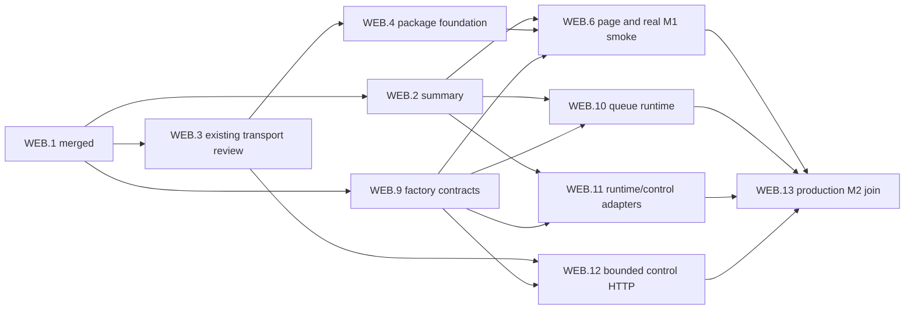

# Local cockpit and automatic queue operation

Accepted scope amendment: 2026-10-18. The user requested the smaller personal
cockpit design be applied to the spec and deeply specified beads. This replaces
the first-delivery sequence accepted on 2026-10-13. Implementation remains paused;
this planning update does not resume dispatch, spend, or resolve execution gates.

Canonical bead index: [web-dashboard-beads.md](web-dashboard-beads.md).
Epic `agalma-rwn` now delivers the first operator cockpit. The original broader
generic-plugin browser promise is retained in deferred epic `agalma-v38`.
Historical inputs/receipts stay immutable. The prior spec/index remain in Git;
before-amendment own bead fields are retained as JSON planning evidence.
This document owns the design; implementation task details live in beads.

## Product and delivery

One operator starts a local factory for one repository/state directory, opens its
printed loopback URL, sees the eligible queue and execution progress, and leaves
workers consuming eligible work automatically. The cockpit remains available
through an empty queue, long tasks and admission pause. Pause/resume controls use
existing factory authority and durable receipts. High-level planning through
concierge is a later increment; there is no per-task Dispatch button.

Two milestones keep a visible page ahead of runtime integration:

| Milestone | Observable result | Acceptance owner |
|---|---|---|
| M1: open the cockpit | Actual browser shows real overview/executions/component health through the production host | WEB.6 |
| M2: operate the queue | Continuous automatic eligible-work consumption, responsive busy/idle UI, verified pause/resume and restart recovery | WEB.13 |

The first page also shows available economics/timeline and eligible work/runtime
observations when supported. Unknown costs, worker state and source availability
remain explicit. M1 may show the factory runtime endpoint unavailable with
controls disabled; this is an intermediate delivery, not M2 acceptance.

Remote access, shared accounts, a frontend framework/npm pipeline, task/backlog
editing, arbitrary commands, per-task worker/model selection, rich plugin-detail
pages, artifact downloads, generic plugin actions and concierge UI are outside
the first release. Existing queue eligibility/approval/stop/spending policies
remain mandatory. Automatic queue consumption does not create/release new tasks.

## Existing implementation and reuse

The inspected main baseline is `1f3649480dbf05472dc5987b38c229c2c4a9b55b`.
HP.1–HP.7 and WEB.1 are closed/merged. HP.8 is incomplete. WEB.2 and WEB.3 have
retained uncommitted worktrees; WEB.3's latest focused evidence records 19/19,
with final review still pending. No dashboard package/browser page exists yet.

`status.rs` now consumes a selected ledger handle; it is not the old direct-SQLite
recipe. Existing snapshot/economics/component functions cover executions,
timeline, costs and registry/report-derived plugins. Reuse those calculations
through hub-owned adapters, without importing conductor implementations into the
dashboard. HP.6 already supplies common component/view derivation.

`work.rs` already selects/claims eligible tasks, freezes inputs, applies budgets
and drives execution/recovery. It currently exits on an empty queue and refuses
stopped entry before starting the plugin host. Its attached host lacks the
standalone host's continuously progressing supervision/callback-serving path.
The runtime increment explicitly repairs those gaps; assets alone cannot do so.

## Package and process boundary

Retain `agalma-web-dashboard` as an independently installed/supervised process.
Its package supplies executable, manifest, configuration schema, protocol version
and committed browser assets. Use public contracts and IPC only. Discover and
launch through the existing registry/supervisor; no dashboard-specific core
import, peer discovery, second supervisor, SQL or private ledger open.

Rust serves compiled HTML/CSS/browser JavaScript modules and bounded HTTP API.
WEB.4 generates a deterministic inventory using std-only build logic; adding an
asset does not require editing server source. Watch source assets, never an
OUT_DIR output. WEB.4 owns Cargo/package/build/server and distinct `health.html`;
WEB.6 owns final page/modules/browser support. No new dependency/download is
authorized. A build-script change includes existing no-op rebuild verification.

Bind `127.0.0.1`, default port 0; reject foreign addresses. Print/report actual
URL only after listener/read binding readiness. Configuration refresh interval
is 1–60 seconds, default 1. Health distinguishes listener, binding and runtime
availability. Missing optional runtime support does not make M1 startup fail.

## Continuous runtime and ownership

Add explicit `agalma work --watch --repo <repo> --state-dir <state>
--plugin-root <packages>`. Reject `--watch` with `--once` or `--max-tasks`.
Existing ordinary batch/once/max-tasks behavior and exit codes remain covered.

One runtime holds the existing state-directory admission lock. One worker owns
queue selection, claim, frozen admission and serial execution. Empty successful
queue means Idle and an interruptible five-second wait; later eligible work runs
through the existing pipeline. Queue error means Unavailable with capped retry
(5 seconds initial, 30 seconds maximum), never successful empty state.

On admitted startup, run existing frozen-package recovery before new claims,
then existing reap/reconciliation/review policy in its established order. Do not
repeat startup recovery/planning on every idle scan or add automatic release,
mining, recurring concierge or a parallel builder scheduler. M3's durable cadence,
operator-directive release, backup and 72-hour acceptance remain separate work.

Three responsibilities progress independently:

1. The worker runs synchronous task execution and is the sole claimant.
2. A host/probe supervision owner is constructed/used in its own context and
   continues supervision during idle, running and paused states (nominal 250ms
   tick with existing backoff). Share only safe selected-ledger/router/report
   handles and short-lived snapshot copies; never mutable host/queue/executor.
3. The hub callback/control event loop remains responsive while the worker
   blocks. The supervised dashboard process separately serves browser HTTP.
   A supervision thread alone is insufficient. Never hold a worker/router lock
   throughout a task or slow read. Wake hints use a bounded channel (capacity16);
   coalescing a hint never drops the durable stop decision.

Pause blocks new admission through existing stop policy; it is not a new cancel
operation and does not change current in-flight phase-stop semantics. Resume
requires the existing human confirmation and receipt. Wake/recheck actual stop
state instead of treating a successful HTTP response as observed worker state.

Continuous-mode startup with STOP/latch may serve observations and confirmed
resume only against readable, compatible established storage. Never initialize,
replace or migrate fresh/missing/corrupt state under stopped admission, clear
stop automatically, or dispatch while recovery/stop authority is unknown.
This is an explicit continuous-mode change, not behavior already in `work()`.

Graceful shutdown stops admission, uses existing cooperative phase/cancellation
deadlines to reach a terminal/parked boundary, then stops/joins hub serving and
host owners, drains owned plugin processes, and finally releases the lock. Forced
termination can leave durable nonterminal execution; next permitted startup
recovers from frozen packages before new work. No fabricated terminal receipt
or force-unlock. Fatal worker failure is visible and requires explicit runtime
restart; plugin-child restart does not create a fresh queue claimant.

## Summary reads

Keep immutable WEB.1 `ControlPlaneRead/v1` / `BrowserWire` and scoped
`control-plane.read/v1`. Supported first-release operations are `read_overview`
and `list_components`, exposed as GET `/api/v1/overview` and
GET `/api/v1/components`. Grant scope/expiry/revocation remain server-validated.

ReadOverview contains stop observation, executions, usage/cost/allowance and
curated timeline from bound APIs. Sources distinguish missing, unreadable,
unknown, successfully empty and available. Unknown usage/allowance is null, not
numeric zero. Missing stop authority cannot become a green Running indication.
No implicit atomic snapshot is claimed across sources.

Overview is capped at100 executions/100 timeline entries and256KiB actual wire
JSON with visible truncation. Component pages default50, accept1–100, and stay
within256KiB including metadata. Sort by opaque ID; cursor pins collection,
filter and revision. Mutation/retired generation invalidates the collection;
RevisionConflict means reacquire. Fingerprint revisions are not monotonic clocks.

Use installed binding/version/config pins plus live host lifecycle/health. An
old Ready report cannot hide a Failed/Retired registry observation. Include
installed unavailable plugins. Do not derive liveness from socket presence.
Preserve exact decimal strings for identity/money in browser projection.

Keep reads available while admission stopped, bounded by five seconds including
queueing/source work, and release router locks before slow I/O. Reads create no
claims/actions. Component-report/artifact operations explicitly unsupported in
this slice; their HTTP routes are absent. Preserve their old code/tests/evidence
before editing the retained WEB.2 worktree. Timestamp/digest matching never
establishes missing producer provenance.

## Factory contracts

WEB.9 defines additive `factory.rs` types, strict codecs and independent golden
fixtures. Existing ControlPlaneRead/v1, HP envelopes and LedgerApi are unchanged.
Capabilities separate `factory.read/v1` (snapshot/lookup) from
`factory.control/v1` (pause/resume). No public body contains actor or credentials.

Requests use exact tags/fields; unknown fields/families/versions fail:

```json
{"format":"FactoryRuntime/v1","operation":"snapshot","limit":50,"cursor":null}
{"format":"FactoryControl/v1","operation":"lookup","action_id":"op-1"}
{"format":"FactoryControl/v1","operation":"pause","action_id":"op-2","confirmation":null}
{"format":"FactoryControl/v1","operation":"resume","action_id":"op-3","confirmation":"resume"}
```

Snapshot limit defaults50/accepts1–100; nullable cursor≤4096 UTF-8 bytes. Omitted
snapshot paging fields take defaults. Action IDs are1–128 ASCII characters from
`[A-Za-z0-9._-]`; action confirmation is required nullable and≤64 UTF-8 bytes.
Preserve exact submitted confirmation for input identity, then apply existing
trimmed confirmation semantics. Request digest is canonical SHA-256 over the
complete validated action object, excluding outer grant/deadline/operationID,
session and CSRF. Distinct submitted input with the same actionID conflicts.

FactoryRuntime/v1 response required fields:

| Field | Exact content |
|---|---|
| format | `FactoryRuntime/v1` |
| repository_id, state_id | Nonempty opaque configured identities≤256bytes; no private absolute paths |
| runtime_instance_id | Nullable opaque launch identity≤128bytes |
| observed_at_unix_ms | ExactU64 decimal string |
| status | Exactly Starting, Recovering, Idle, Running, Paused, Failed, Unavailable |
| reason | Nullable text≤2048bytes |
| sources | Exactly five unique records for runtime, worker, queue, execution, stop |
| stop | Nullable stop observation |
| current_execution | Nullable observed execution summary |
| eligible | Bounded eligible-work page |
| permissions | `{pause:bool,resume:bool}`, false by default |

Source record: `{source,state,detail,observed_at_unix_ms}` using existing
SourceState, nullable bounded detail and nullable ExactU64 timestamp.
Stop: `{stopped,reason,observed_at_unix_ms}`, bounded nullable reason and exact
timestamp. Execution: `{execution_id,task_id,generation,phase,state,
updated_at_unix_ms}` using existing phase/state enums, exact generation, nullable
exact update time and IDs≤256bytes. Unknown time is null, never invented zero.

Eligible page: `{entries,revision,total,next_cursor}`; entries are
`{task_id,title,priority,family}` using TaskPriority/TaskFamily, title≤1024bytes,
IDs≤256bytes. At most100 entries and256KiB entire response. Revision is nullable
opaque string≤128bytes; total nullable ExactU64; cursor nullable≤4096bytes.
Sort task_id for display; this does not change dispatch selection priority.
Unavailable can have null launch/revision/total/execution and empty entries
without claiming a successfully empty queue. All nullable response keys exist.

Observation seam in contracts:

```rust
pub trait RuntimeObservationSource: Send + Sync {
    fn snapshot(&self, request: &FactoryRuntimeRequest)
        -> Result<FactoryRuntime, ContractError>;
}
```

WEB.10 owns queue order/revision/cursor/source truth; WEB.11 only validates and
adapts it. Queue cursor is canonical JSON text, opaque to browsers:
`{format:"FactoryQueueCursor/v1",repository_id,state_id,runtime_instance_id,
revision,after}`. Fields are bounded/nonempty and pin scope/launch/collection.
Malformed/wrong scope returns InvalidRecord; changed queue revision/launch
returns RevisionConflict. Golden literals freeze encoding. WEB.10's raw source
permissions default false. WEB.11 is the sole trusted permission composer: it
may enable pause/resume only from source availability, the authenticated caller's
current approved factory.control binding, exclusive owner and observed stop
state. WEB.13 supplies the live binding/owner resolver. WEB.12 and the browser
can only narrow this result. UI permissions are hints, never admission authority.

FactoryControl/v1 responses are strict tagged variants, all with nullable live
`observed_stop` separate from immutable history:

- `result:"receipt"`, `receipt:{action_id,request,request_digest,outcome,
  reason,ledger_action_id,actor,recorded_at_unix_ms}`. Outcome applied/denied,
  actor human, timestamp exact, nullable reason≤2048bytes.
- `result:"unconfirmed"`, original action_id/request/request_digest,
  `code:"EffectUnconfirmed"`, bounded reason; no terminal receipt.
- `result:"not_found"`, action_id. Only authoritative lookup can say absent.

Whole response≤256KiB. Reuse existing FailureCode values; no frozen failure enum
extension for HTTP-only session/content errors. A completed historical timestamp
is replayed exactly. Receipt success and observed worker progress are distinct.

## Control replay, stop admission and authority

Existing `ControlPlane::apply` changes latch/STOP before recording an outcome;
it does not preserve complete original request identity or atomically commit all
effects. The new API promises conservative replay, not atomic exactly-once
completion. Preserve legacy CLI/TUI apply/cancel behavior.

One serialized API control owner holds a dedicated state-scoped
`factory-control.lock` guard; a process mutex alone is insufficient. WEB.13
establishes ownership for the service lifetime. Unbound/competing owner means
disabled controls. Legacy CLI/TUI never uses this API's reserved action IDs.

Use existing declared ControlReceipt storage, with deterministic IDs
`factory-control.intent/<action_id>` and `factory-control.result/<action_id>`.
Fields use action pause/resume, target empty, actor human, and a namespaced
`factory_control_v1` detail with stage, exact request and digest; terminal detail
adds actual outcome/reason. No SQL or parallel journal framework.

1. Authenticate method/capability/pinned identity/expiry and strictly decode.
2. Serialize at exclusive owner; recheck deadline/authority after waiting.
3. Matching completed record replays exactly; conflicting input fails before
   effects. Matching orphan intent returns unconfirmed without reexecution.
4. Otherwise persist intent before effect; uncertain intent write never
   authorizes effect. Reconcile or return explicit unavailable/unknown.
5. Apply existing human guards/checked pause/resume semantics, then persist and
   return terminal result. A mutation/result-write failure leaves uncertainty.
   New-path Resume must not claim success if STOP removal/observation failed.

Lookup is observational. An interrupted effect/result boundary returns
EffectUnconfirmed; browser does not retry with another ID automatically. A
stronger atomic guarantee requires a separate ledger prerequisite.

Pause/resume must be callable while admission stopped. Add a narrow authenticated
factory-control exception after operation validation; do not disable ordinary
effect stop policy or admit arbitrary plugin capabilities. Missing/unreadable
state still fails closed. Read/lookup remains observational while stopped.

Control authority is explicit for the installed dashboard binding/package digest,
not inherited from auto-install, a UI actor field or plugin report. Do not add
factory.control/v1 to the automatic safe-capability allowlist. Default package
is read-only. Live grant expiry/revocation/generation still gates every call.

## Private launch bindings and HTTP controls

WEB.13 issues a generic private descriptor, WEB.12 parses/consumes it:

```json
{"format":"PluginCapabilityBindings/v1","bindings":[{"capability":"factory.read/v1","hub_socket":"<private path>","grant":"<private token>","plugin_id":"<installed id>","generation":"1"}]}
```

Environment key `AGALMA_PLUGIN_CAPABILITY_BINDINGS`, max64KiB/16 unique capability
entries. Capability≤128bytes, pluginID≤256bytes, exact generation; socket/token
remain bounded by existing launch constraints. Reject duplicates/malformed
binding identity; no log/Describe/HTTP disclosure. Preserve legacy first-grant
inputs for old clients, but never use a read/report token as control fallback.
Issue/rotate/revoke each approved capability independently. This private additive
channel does not change public frozen HP envelopes.

| HTTP route | Capability/behavior |
|---|---|
| GET /api/v1/factory | factory.read snapshot |
| GET /api/v1/factory/actions/{action_id} | factory.read receipt lookup |
| POST /api/v1/factory/pause | factory.control pause |
| POST /api/v1/factory/resume | factory.control confirmed resume |

Retain configured loopback Host and same-origin policy. With explicit actual
control binding, same-origin factory GET may bootstrap per-launch independent
32-byte OS-random session/CSRF tokens. Cookie `agalma_operator`, HttpOnly,
SameSite=Strict, Path=/api/v1/factory; plain loopback HTTP omits Secure. Separate
CSRF in `X-Agalma-CSRF` response header, Cache-Control:no-store. Tokens never in
URLs/errors/logs; rotate on restart. No accounts/framework. No control binding
means no session/outbound mutation and disabled permissions.

POST requires exactly one valid Origin matching actual scheme/host/port, valid
cookie+CSRF, live explicit control binding and bounded strict JSON with matching
route operation. Missing/foreign/duplicate/malformed Origin fails. Body≤8192bytes
including streamed/chunked input, application/json with optional charset=utf-8.
The existing max16 admitted requests and five-second total budget apply to body
acquisition/queueing/RPC/response. No unbounded slow-body/admission queue.

HTTP mapping: completed applied/denied receipt200; unconfirmed202; lookup
not_found404; identity/revision conflict409; invalid schema/input400; authority,
session/Origin/CSRF or disabled controls403; unavailable/busy503; deadline504;
body413; contenttype415; unsupported method405; unknown route404. A possible
effect on timeout/disconnect is unknown, not cancelled; retain ID for lookup.
Keep bounded safe errors and no secret reflection. WEB.3 read/drain behavior
remains protected. Only declared control routes accept POST.

## Browser state and refresh

Use one page and browser-native modules. `api.js` validates contracts;
`app.js` renders the shell; `refresh.js` owns reads; `controls.js` owns explicit
pause/resume interactions. Independent WEB.9 JSON fixtures let UI and backend
develop in parallel. No private implementation imports or remote UI dependencies.

One refresh cycle at a time, default1s/config1–60s, abortable5s requests. Track
last success per source; one failing endpoint does not erase successful others.
Retain failed-source data visibly stale; first failure is unavailable. Generation
change replaces old current row state. RevisionConflict resets page collection;
older aborted replies cannot overwrite later cycles. Page exit stops timers and
requests. Opaque identities/revisions/money never become floating point.

Use textContent/createTextNode for plugin text. Bound text4KiB, rows100/page,
explicit truncation/Next. Never evaluate report HTML/scripts/templates. Controls
disabled when runtime/permission unknown or absent. Explicit Resume collects
literal existing confirmation. Pending click retains one actionID; lost result
queries it. GET/refresh/navigation/reconnect/reload never repeats POST.

## Parallel ownership and task graph

Three active implementation streams, not one chain of eight browser tasks:

| Stream | Tasks | Exclusive source ownership |
|---|---|---|
| A | WEB.2 summary; WEB.9 contracts; WEB.11 adapters as available | Read handlers/economics/routing/contract exports; lib.rs after WEB.2 |
| B | WEB.10 continuous runtime | work.rs, cli.rs, work/factory_runtime.rs; composition after WEB.2 |
| C | WEB.4 foundation then WEB.6 page | Cargo/package/server/build, then page/assets/browser support |

Finish existing WEB.3 review separately. WEB.12 gets IPC ownership after WEB.3
and uses the next free implementation slot; fixed fixtures allow work without
WEB.10/11 runtime completion. Initially summary/contract/package work can overlap;
once contracts and summary land, runtime/adapter/browser work can overlap.
The three-session limit is a dispatch cap, not a claim that every dependency
wave has width three. The four-task ready wave queues its fourth task until a
slot opens; necessary contract and final integration joins remain sequential.

WEB.10 declares `work::factory_runtime` from its owned work.rs, avoiding concurrent
lib.rs edits with WEB.11. Composition transfers WEB.2→WEB.10→WEB.13. Package server
transfers WEB.4→WEB.13. Browser support begins WEB.6, then later readers consume
the same harness. No concurrent shared-file ownership or competing inventories.



## Verification, review and delivery

Each bead contains concrete files, algorithms, failure/recovery states, target
selection, property budget/seed, prerequisites and stopping conditions. Use
`make test-focused SELECTION=...`/unified runner, named task worktrees and
absolute redirected caches. Keep all raw logs/commands/environment/source/pending
identity/fixtures/results under primary `target/test-runs/<bead>/<run-id>/`.
Required browser/binary cases execute; missing/ignored/zero is failure.

Contract/read/transport tests precede integrations. WEB.4 package-level fixture
tests prove executable/bootstrap, not production hub composition. WEB.6 proves
actual M1 with installed CHROME_BIN and real hub/dashboard/ledger. WEB.13 proves
actual continuous runtime/controls with deterministic local reference tasks:
empty→Idle→eligible task→busy responsive UI→pause holds next claim→confirmed
resume→one next claim, plus read-only/refused controls, duplicate/conflicting
identity, interrupted intent/effect/result, frozen restart recovery, second-owner
refusal, stopped-established versus fresh no-init and clean shutdown.

WEB.6 browser acceptance is intentionally bounded to one production smoke plus
six fixture browser regressions: safe bounded rendering of real fixture data;
inert injected text; stale-source retention and conflict reload; bounded
component paging; permission-gated controls with receipt lookup and no replay;
and page-exit timer/abort cleanup. The production smoke opens the installed
dashboard in CHROME_BIN and checks real overview/execution/component data,
source loss, and disabled controls without a grant. Do not run the prior
128-sequence browser state-machine corpus as a WEB.6 release gate. Broader
generated and out-of-order coverage is deferred to a later task if a concrete
regression justifies it.

Save independent deterministic property generators/assertions, boundary/invalid
cases and minimized replay data in repository tests. Budgets are specified per
bead; use existing native infrastructure, no new framework. No paid provider.
Run at most two isolated test binaries concurrently by default, coordinate cache
compilation, keep unique state/ports/profiles. Do not run full workspace per bead;
preserve later WEB.8 full acceptance. Broader new runtime checks need a named
coverage reason, not a routine second suite after passing focused evidence.

Implement via OpenCode DeepSeek Flash/Luna. Separate DeepSeek reviews routine
package/UI work; Sol reviews contracts, routing, control uncertainty and runtime
integration. Validator structural difficulty labels do not automatically select
review model. Stop at accepted evidence/handoff or one blocker/30-minute bounded
investigation. Commit/merge only reviewed explicit task paths before closure,
stamp actor/implemented-by, preserve evidence and remove only clean merged task
worktrees/caches. No push. Current planning does not dispatch implementation.

## Retained later platform and concierge scope

Deferred epic `agalma-v38` owns the original generic reporting-browser promise.
WEB.5, WEB.7 and WEB.8 keep their IDs under that parent. Its provenance design
and implementation tasks distinguish producer publications from recovered state:
frozen PluginSnapshot/v1 cannot reconstruct all original identity. Design first,
then actual versioned source/client implementation; rich renderer depends on
implementation, not a design closure. No timestamp/digest heuristic.

Retain six blocks Status/Metrics/Table/Timeline/Alert/ArtifactLink; literal/slash
field selectors with ~0/~1 escapes; bounded generic fallbacks and unknown versions;
no plugin code/templates/private payload types in hub. Rich navigation derives
from registry with stable identity/generation. Deferred artifacts use current
authorized immutable references,64KiB chunks/16MiB totals, confined verified
storage and attachment/no-sniff. Keep stale/gap/restart/generation recovery and
previously unknown independently built plugin proof with unchanged hub/dashboard
digests. WEB.8 retains one full workspace acceptance after its focused proof.
HP.8 remains a prerequisite for that platform proof, not the first cockpit.

Deferred task `agalma-1o7` designs concierge goal intake using existing planner,
budgets, frozen inputs and human execution gates. Planning produces proposals;
authority makes work eligible; the same queue worker consumes it. No second
scheduler or inferred execution approval from submitting a goal. Defer means
deliberate postponement, not a fake execution-approval date.

## UI v2 amendment: multi-page cockpit and design pass

User-directed increment after the M1/M2 cockpit delivery (epic `agalma-82f`,
2026-10-18). Scope: multi-page navigation over the currently available reads,
the hub component registry with health, task and project views, component detail
and dashboard self-health routes, and a full visual (`dashboard.css`) pass. No
new hub contracts and no new data semantics: every page renders existing
`ControlPlaneRead/v1`, `FactoryRuntime/v1` and dashboard health observations.
Full task metadata (budget/acceptance/base_ref/target/directive) remains
unavailable in this increment; it lives in taskqueue records and is not exposed
by any read contract. Implementation stays subject to the standing rules:
independently installed/supervised `agalma-web-dashboard` process, loopback-only
HTTP, compiled asset inventory, `textContent`-only rendering,4KiB text/100-row
bounds, explicit unknown/stale states, no POST from navigation, page-exit
timer/abort cleanup, no downloads or frontend frameworks.

### Pages and hash routing

One compiled shell (`index.html` plus browser-native ES modules). Hash routes:

| Route | Page content | Reads |
|---|---|---|
| `#/overview` | runtime status, stop latch, current execution, economics, timeline, controls | overview + factory |
| `#/components` | registry table: plugin id, name, generation, health, freshness, completeness, available, declared views; opaque-cursor paging | components |
| `#/components/<plugin_id>` | binding pin, declared view descriptors, bounded report envelopes | `read_component` via new HTTP route |
| `#/tasks` | eligible queue (id, title, priority, family, total, revision) and executions (phase, state, attempt, revision, updated) | factory + overview |
| `#/projects` | repository/state opaque identity, the five runtime sources, stop state, component count | factory + components |
| `#/system` | dashboard self-health (listener URL, binding, health state, version, detail), refresh interval and read-source states | new `/api/v1/status` |

Hash routing is required: the preview target and the Rust transport serve one
static shell, so deep links must not need a server rewrite; the History API is
rejected. An unknown or empty hash resolves to `#/overview` with a visible
notice. Navigation, hash change, reload and refresh never submit a control POST.
Read registration is unchanged except for the detail read: overview, factory and
components keep their existing always-on registration (component data also
feeds the Projects page count); only the detail read is route-active, fetching
while its route is active and short-circuiting otherwise so the refresh module
itself needs no change. The controls panel moves to the overview page unchanged
in behavior. The brand heading "Agalma cockpit" and the honest
runtime-unavailable wording remain (retained DOM contract).

### New read routes

Exactly two new dashboard routes, read-only, reusing the existing adapter gate:

- `GET /api/v1/components/{plugin_id}`: `read_component` page (`limit`1–100
  default50, opaque `cursor`). The transport already refuses smuggled path
  separators; the handler validates the decoded segment with the single shared
  component-id rule (exposed `pub` in `agalma-ipc`, reused, not duplicated).
  Malformed plugin id or request →400 `invalid_request`; cursor revision
  conflict →409 `cursor_conflict`; deadline →504 `read_timeout`; binding
  unavailable →503 `read_unavailable`; success →200 exact `BrowserWire`
  projection with exact decimal string identities. A valid but unknown plugin
  id answers200 with missing-source metadata and the page renders the honest
  not-registered state, never404 and never an empty healthy page.
- `GET /api/v1/status`: local process facts only, never hub data and never
  requiring the read binding. Strict JSON `DashboardStatus/v1`:
  `{format,version,health_state,listener:{state,url},binding:{state},detail,
  observed_at_unix_ms}` with Ready/Degraded/Unavailable derived by the existing
  `plugin.Health` rule and nullable bounded detail. Private launch inputs
  (socket, grant, capability token, config path, config digest, generation,
  capability bindings) never enter any browser response.

### Browser modules, fixtures and verification

Module layout: `api.js` (adds `getComponentDetail`, `getStatus`), `refresh.js`
and `controls.js` unchanged, new `router.js` and `ui.js`, and `pages/
{overview,components,component,tasks,projects,system}.js` with `app.js` as the
shell. All WEB.6 invariants carry over. Visual pass: design tokens with
dark-first `prefers-color-scheme` light override, sidebar→top nav at720px,
status/health pills, card panels, dense sticky-header tables, timeline stream,
`focus-visible` rings, monospace reserved for ids/digests/cursors/code, no
webfonts/downloads/frameworks. New fixtures `component-detail.json` and
`status.json`; `make start` previews every route offline with a committed
stdlib-only preview server. Browser acceptance extends the retained
`browser_support` harness; Rust route cases extend the `package_lifecycle`
patterns and one `agalma-ipc` focused check covers the exposed validator. Task
mapping: UI.1 `agalma-82f.1`, UI.2 `agalma-82f.2` (blocked by UI.1), human
gates `agalma-5fv`/`agalma-9ur`; compact index in
[web-dashboard-beads.md](web-dashboard-beads.md).
